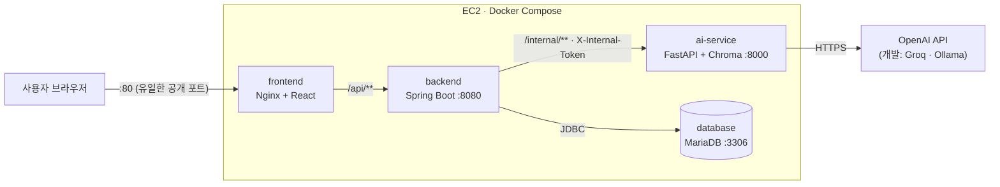
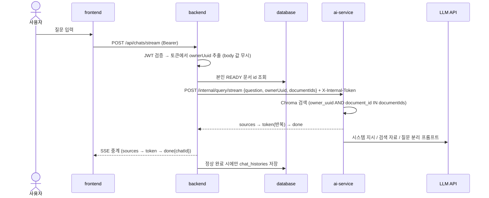

# 시스템 아키텍처 설계서

## 1. 시스템 개요

학생이 개인 계정에 PDF 수업 자료를 올리고 질문하면, **본인이 올린 자료만 근거로** 만든 답변을 스트리밍(SSE)으로 보여 주고 출처(문서명 · 페이지)를 함께 표시한다.

### 1.1 주요 컴포넌트

| 컴포넌트 (Compose 이름) | 역할 | 운영 외부 공개 |
|--------------------------|------|----------------|
| **Frontend** (`frontend`, React + Nginx) | 화면 5종, `/api/**`를 Backend로 리버스 프록시 | ✅ 80만 |
| **Backend** (`backend`, Spring Boot) | 인증 · 인가 · 소유자 검증, 자료 · 기록 관리, AI 호출 · SSE 중계, 감사 로그 | ❌ |
| **AI Module** (`ai-service`, FastAPI + LangChain) | PDF 적재, 소유자 필터 검색, 답변 스트리밍 | ❌ |
| **Database** (`database`, MariaDB) | 회원 · Refresh Token 해시 · 자료 정보 · 질문 기록 | ❌ |
| **Vector DB** (Chroma, `ai-service`에 내장) | 청크 임베딩 + 메타데이터(`owner_uuid` · `document_id` · `document_name` · `page`) | ❌ |
| **LLM / 임베딩 API** | 개발: Groq + Ollama `bge-m3` / 배포: OpenAI | AI Module만 호출 |

- **Frontend는 AI Module · DB를 직접 호출하지 않는다.** 반드시 Backend를 거친다.
- RDB와 Chroma는 `documents.id` = `document_id`, `members.uuid` = `owner_uuid`로 연결된다.
- 답변에는 DB에서 `READY`로 확인된 본인 문서만 쓰고, 모델은 환경변수로만 전환한다(코드 수정 없음).

## 2. 시스템 구성도



| 서비스 | 포트 | 로컬 개발 | 운영 (EC2) |
|--------|------|-----------|------------|
| frontend | 80 (개발 5173) | Vite `5173` | `80:80` 게시, 보안그룹 80 허용 |
| backend | 8080 | `127.0.0.1:8080` | 게시 안 함 (Nginx 경유) |
| ai-service | 8000 | `127.0.0.1:8000` | 게시 안 함 |
| database | 3306 | `127.0.0.1:${DB_LOCAL_PORT:-3306}` | 게시 안 함 |

- 운영 Compose는 네트워크를 `edge-net`(frontend · backend), `ai-net`(backend · ai-service), `db-net`(backend · database, `internal: true`)으로 나눈다. frontend는 ai-service · database에 닿을 수 없다.
- SSH(22)는 팀원 IP만 허용한다. 볼륨: `db-data`, `chroma-data`

## 3. 기술 스택

| 구분 | 기술 | 버전 · 이미지 |
|------|------|---------------|
| Frontend | React, Vite, React Router, Zustand, axios + fetch 스트리밍, Tailwind CSS / Nginx | React 19.3.x / `node:24-alpine` → `nginx:alpine` |
| Backend | Spring Boot, Spring Security, Spring Data JPA, JJWT, WebClient, Flyway, Actuator | Java 17, Boot 4.0.x, Security 7.x / `eclipse-temurin:17-jre` |
| AI Module | FastAPI(SSE), LangChain(LCEL, PyPDFLoader, RecursiveCharacterTextSplitter), uv | Python 3.12, uv 0.12.23 / `python:3.12-slim` |
| LLM · 임베딩 | 개발 Groq · Ollama `bge-m3`(1024차원) / 배포 OpenAI · `text-embedding-3-small`(1536차원) | 환경변수 `LLM_*` · `EMBEDDING_*` |
| Database | MariaDB + Flyway(`ddl-auto: validate`) / Chroma(PersistentClient) | `mariadb:10.11` |
| Infra · 보안 도구 | Docker Compose v2, GitHub Actions, Docker Hub, AWS EC2 / gitleaks, Burp Suite, CycloneDX(SBOM), `npm audit` | gitleaks 8.21.2 |

## 4. 컴포넌트 구조

### 4.1 Frontend (`frontend/`)

```
frontend/
├── src/
│   ├── pages/        # LoginPage, SignupPage, ChatPage, DocumentsPage, HistoryPage
│   ├── components/   # ChatMessage, SourceCard, FeedbackButtons, FileUploader, LoadingSpinner, ProtectedRoute
│   ├── services/     # api.js(axios · 401 시 토큰 재발급), chatStream.js(fetch + SSE 파싱)
│   ├── store/        # authStore(Access Token 메모리 보관), chatStore (Zustand)
│   └── hooks/        # useChatStream, useDocuments
├── nginx.conf        # /api 프록시, SSE 버퍼링 off, 보안 헤더
└── Dockerfile        # node 빌드 → nginx 실행 (멀티스테이지)
```

- AI 응답은 텍스트로만 렌더링한다(`dangerouslySetInnerHTML` 미사용).

### 4.2 Backend (`backend/`)

```
backend/src/main/
├── java/.../
│   ├── config/       # SecurityConfig, CorsConfig, WebClientConfig
│   ├── security/     # JwtProvider, JwtAuthenticationFilter, 401/403 핸들러
│   ├── auth/         # 회원가입 · 로그인 · 재발급 · 로그아웃
│   ├── member/       # Member 엔티티, 로그인 실패 잠금
│   ├── document/     # 업로드 · 목록 · 삭제, PDF 검증
│   ├── chat/         # 질문 SSE 중계, 기록 · 피드백
│   ├── ai/           # AiClient (X-Internal-Token, 타임아웃 · Fallback)
│   └── common/       # GlobalExceptionHandler, AuditLogger
└── resources/
    ├── application.yml   # 비밀정보는 ${ENV} 참조만
    └── db/migration/     # Flyway V1__init.sql ...
```

- 계층은 `controller → service → repository → entity`이며, 소유자 검증은 service 계층에서 한다.

### 4.3 AI Module (`ai-module/`)

```
ai-module/src/
├── api/          # main.py, routers: documents.py(적재 · 삭제), query.py(SSE), health.py
├── chains/       # rag_chain.py (Retriever → Prompt → LLM → Parser, LCEL)
├── core/         # config.py(환경변수), security.py(내부 토큰 검증), llm.py · embeddings.py(공급자 선택)
├── services/     # ingest.py(PyPDFLoader → Splitter → Chroma), vectorstore.py(소유자 필터 검색 · 삭제)
└── schemas/      # Pydantic 요청 · 응답 모델 (질문 길이 제한)
```

- 청크 800자 · 오버랩 100자, 검색 k=4로 시작한다(`3.데이터베이스설계서.md` 4장).

## 5. 데이터 플로우

### 5.1 질문 · 답변 스트리밍 (핵심 흐름)



- AI 오류 · 타임아웃(60초)이면 `error` 이벤트로 고정 문구만 보내고 기록은 저장하지 않는다. 이벤트 형식은 `4.API설계서.md` 5.1 참고.

### 5.2 그 밖의 흐름

| 흐름 | 순서 |
|------|------|
| 로그인 | `POST /api/auth/login` → 잠금 확인 · BCrypt 검증(5회 실패 시 15분 잠금) → Access Token(15분) + Refresh Token(1일, DB에는 SHA-256 해시) 발급 → 만료 시 `POST /api/auth/refresh`로 회전 |
| 자료 업로드 | `POST /api/documents` → PDF 검증(확장자 · `%PDF-` · 10MB) → DB 저장(INDEXING) → `POST /internal/documents` 적재 → READY. 실패 시 청크 삭제 후 DB 행 삭제. 원본 PDF는 저장하지 않음 |
| 자료 삭제 | `DELETE /api/documents/{id}` → `id + member_id`로 소유자 확인(남의 자료 403) → `DELETE /internal/documents/{documentId}` → DB 행 삭제 |
| 기록 · 피드백 | `GET /api/chats`(본인 기록만), `PATCH /api/chats/{id}/feedback`(소유자 확인, 남의 기록 403) |

## 6. 보안 아키텍처

> 상세 점검 결과는 `9.보안점검서.md`에 쓰고, 여기서는 구조적 보안 설계만 다룬다.

### 6.1 신뢰 경계(Trust Boundary)

| 경계 | 구간 | 공개 여부 | 인증 · 인가 |
|------|------|-----------|-------------|
| ① EC2 보안그룹 | 인터넷 → frontend | 외부 공개 (80) | 없음 (정적 파일) |
| ② JWT 필터 | frontend → backend `/api/**` | 외부 공개 (Nginx 경유) | `/api/auth/**`(logout 제외)는 인증 없음 + 로그인 실패 제한, 그 외는 JWT + 소유자 검증 |
| ③ 내부 네트워크 | backend → ai-service | 내부 전용 (포트 미게시) | `X-Internal-Token` (상수 시간 비교, 틀리면 401) |
| ③ 내부 네트워크 | backend → database | 내부 전용 (`internal` 네트워크) | 앱 전용 DB 계정 (root 미사용) |
| ④ 외부 API | ai-service → LLM API | 아웃바운드만 | API Key (환경변수) |
| - | 사용자가 올린 PDF 내용 | 신뢰하지 않는 입력 | 프롬프트에서 시스템 지시와 분리 (간접 프롬프트 인젝션 대비) |

### 6.2 인증 · 인가

- **인증 (JWT)**: Access Token 15분, subject는 회원 **uuid**, `Authorization: Bearer`로 전달. Refresh Token 1일, DB에는 SHA-256 해시만 저장하고 재발급 시 회전 · 로그아웃 시 삭제. 화면은 Access Token을 메모리, Refresh Token을 sessionStorage에 보관한다.
- **CSRF**: 쿠키를 쓰지 않고 헤더 · body로 토큰을 주고받으므로 비활성화한다. 변경 · 삭제에는 GET을 쓰지 않는다.
- **인가**: 역할 `MEMBER` / `ADMIN`(Actuator 전용) + service 계층 **소유자 검증**(`id + member_id`, 불일치 403). AI에 넘기는 `ownerUuid` · `documentIds`는 Backend가 토큰과 DB로 만든 값만 쓴다.

### 6.3 보안 설계 원칙 적용 내역

| 원칙 | 적용 |
|------|------|
| Defense in Depth | 보안그룹(80만) → Nginx 보안 헤더 → JWT 필터 → 역할 검사 → 소유자 검증 → JPA 파라미터 바인딩 |
| Least Privilege | 앱 전용 DB 계정, Actuator `health,info`만 노출 · ADMIN 전용, ai-service는 backend만 호출 가능, Actions `permissions: contents: read` |
| Secure by Default | `anyRequest().authenticated()` 기본 거부, CORS Origin 한정, `ddl-auto: validate`, 로컬 포트도 `127.0.0.1` 바인딩 |
| Never Trust Input | DTO `@Valid`, PDF 시그니처 · 크기 검증, 소유자 uuid는 토큰에서만, 질문 1~1000자 · `max_tokens` 제한 |
| Fail Securely | AI 오류 시 고정 문구 · 기록 미저장, 500 응답에 스택 트레이스 미노출 |
| Zero Trust | 내부 네트워크 안의 Backend → AI 호출도 내부 토큰으로 검증 |

### 6.4 비밀정보 관리

| 관리 대상 | 로컬 개발 | 배포 |
|-----------|-----------|------|
| `MARIADB_ROOT_PASSWORD`, `MARIADB_PASSWORD`, `JWT_SECRET`, `AI_INTERNAL_TOKEN`, `ADMIN_EMAIL`, `ADMIN_PASSWORD` | `.env` | GitHub Secrets → EC2 `.env` (권한 600) |
| `GROQ_API_KEY` / `OPENAI_API_KEY` (사용 시 `TAVILY_API_KEY`, `LANGSMITH_API_KEY`) | `.env` | GitHub Secrets → EC2 `.env` |
| `DOCKERHUB_USERNAME`, `DOCKERHUB_TOKEN`, (가산 CD) `EC2_HOST` · `EC2_USER` · `EC2_SSH_KEY` | - | GitHub Secrets |

- 코드 · `application.yml` · Compose 파일에는 `${변수}` 참조만 둔다. `.env`는 `.gitignore`에 등록하고 `.env.example`(값 없음)을 제공한다. (가산) K8s는 Secret · ConfigMap으로 분리한다.
- 유출 방지: 커밋 전 pre-commit(gitleaks) + CI `secret-scan.yml`(push · PR 시 전체 이력 검사) + GitHub Secret scanning · Push protection.
- 유출이 의심되면 즉시 강사에게 알려 키를 폐기 · 재발급한다.

### 6.5 감사 로그 · 보안 헤더

- **감사 로그**: 로그인 성공 · 실패 · 잠금, 401 · 403(필터 단계 `SecurityConfig` 핸들러 + `GlobalExceptionHandler` 양쪽)을 시각 · IP · URI · 회원 uuid와 함께 남긴다. 이메일은 마스킹하고, 비밀번호 · 토큰 · API Key는 남기지 않는다.
- **보안 헤더 (Nginx)**: `Content-Security-Policy`(`default-src 'self'` 기반, 최종 값은 6번 문서), `X-Content-Type-Options: nosniff`, `X-Frame-Options: DENY`, `Referrer-Policy`, `server_tokens off`.

### 6.6 알려진 한계

| 한계 | 현재 완화책 | 개선안 |
|------|-------------|--------|
| 운영이 HTTP(80)만 사용 (평문 전송) | 시연 환경 한정, 짧은 Access Token · Refresh 회전 | HTTPS(443) 적용 |
| Refresh Token을 sessionStorage에 보관 (XSS 시 탈취 위험) | CSP, AI 응답 텍스트 렌더링, 토큰 회전 | HttpOnly 쿠키 전환 (이때 CSRF 보호 활성화) |
| 계정 잠금 악용 (남의 계정 15분 잠금) | 자동 해제, 감사 로그 | IP 단위 요청 제한 |

## 7. 배포 · CI/CD

| 항목 | 로컬 개발 | 배포 (EC2) |
|------|-----------|------------|
| Compose | `docker-compose.yml` | `docker-compose.prod.yml` (frontend 80만 게시, Docker Hub 이미지 pull) |
| LLM · 임베딩 | Groq · Ollama `bge-m3` | OpenAI · `text-embedding-3-small` |
| Chroma 컬렉션 | `study_materials_bge-m3` | `study_materials_text-embedding-3-small` (배포 환경에서 재적재) |

- 흐름: 작업 브랜치 → PR(리뷰 1명) → `develop` → 배포 직전 PR → `main` → GitHub Actions가 이미지 3종 빌드 · Docker Hub Push → EC2에서 `docker compose pull && up -d`
- 모든 PR에서 gitleaks 검사를 통과해야 병합된다. 상세 절차는 `8.컨테이너배포가이드.md` 참고.

## 8. 확정 필요 항목 (⚠️)

| # | 항목 | 담당 |
|---|------|------|
| 1 | `.env.example`의 `JWT_REFRESH_EXPIRATION`을 1일(`86400000`)로 수정, `ADMIN_EMAIL` · `ADMIN_PASSWORD` 추가 | 서다영 |
| 2 | LLM 모델명 (Groq · OpenAI) | 강찬식, 김지우 |
| 3 | Compose 네트워크 분리 적용 (Day 3), 이미지 태그 고정, SSH 허용 IP | 서다영 |
| 4 | CSP 최종 값, HTTPS 적용 여부 | 전승호, 서다영 |
