# 보안 점검서

> AskNote (수업 자료 기반 AI 학습 도우미) · 취합 윤수연
> OWASP Top 10 기준으로 **우리 팀 애플리케이션을 직접 점검**하고, 발견한 취약점과 조치 결과를 기록한다
> "적용했다"가 아니라 **"점검 → 발견 → 조치 → 재확인"** 의 근거(코드, 화면, 로그)를 남긴다. 해당 없는 항목은 "해당 없음"과 사유를 적는다
> 표기: ☑ 재확인 완료 / □ 점검 예정 · 진행 중 / 캡처는 `docs/images/security/` (토큰 값이 보이는 화면은 쓰지 않는다)

## 1. 점검 개요

| 항목 | 내용 |
|------|------|
| 점검 대상 | Backend(Spring Boot) / Frontend(React) / AI Module(FastAPI) / 인프라(Docker, 배포) |
| 점검 기준 | OWASP Web Top 10 (2025), OWASP API Security Top 10 (2023), OWASP LLM Applications Top 10 |
| 점검 도구 | 점검 스크립트(`backend/scripts/*.sh`), Burp Suite, gitleaks(CI), `npm audit`, SBOM(CycloneDX), 수동 코드 리뷰 |
| 점검 기간 | 2026-11-07 \~ 2026-11-12 |
| 점검자 | Backend 윤수연 · 정성재 / Frontend 전승호 / AI 강찬식 · 김지우 / 인프라 서다영 (취합 윤수연) |

## 2. Backend 점검 (Spring Boot)

| # | 점검 항목 | 점검 방법 | 발견 여부 | 조치 내용 (클래스/설정 위치) | 재확인 |
|---|-----------|-----------|-----------|------------------------------|--------|
| B-1 | SQL Injection | 코드 리뷰 + 로그인 · 회원가입 · 경로 변수 · 질문에 `' OR '1'='1`, `' --`, `UNION SELECT`, `'; DROP TABLE members; --` 시도 (`sqli-check.sh`) | 미발견 | JPA 메서드 쿼리, `@Query`는 `:param` 바인딩만 사용 (`repository/`), 문자열 연결 쿼리 없음 / 로그인 401, 형식 검증 400, 질문은 문자열로 저장, 500 없음, 이후 정상 로그인 ([캡처](images/security/sqli-check.png)) | ☑ |
| B-2 | 접근 제어 / IDOR | 다른 회원 토큰으로 남의 자료 삭제 · 남의 기록 피드백 수정 시도 (`document-check.sh`, `feedback-check.sh`) | **발견** (자료 삭제 204, 피드백 수정 200) | 소유자 검증 → 403 + 감사 로그 `OWNERSHIP_DENIED` (`DocumentService.delete` — **6.1**, `ChatHistoryService.updateFeedback` — **6.4**) | ☑ |
| B-3 | 인증 / JWT | 토큰 없음 · 위조 토큰으로 보호 API 요청, secret 하드코딩 확인 | 미발견 | Access 15분 · Refresh 분리, subject = uuid, `JWT_SECRET` 환경 변수(32바이트 미만 기동 실패) (`JwtTokenProvider`, `JwtAuthenticationFilter`) | ☑ 401 확인 |
| B-4 | Refresh Token 관리 | 재발급 후 이전 Refresh 재사용, 로그아웃 후 재사용 | 미발견 | 무작위 값 + DB에는 SHA-256 해시만, 재발급 시 기존 행 삭제(회전), 로그아웃 시 삭제 (`AuthService`, `RefreshTokenUtil`) | ☑ 재사용 401 |
| B-5 | 로그인 Brute Force | 틀린 비밀번호 10회 연속 후 올바른 비밀번호로 로그인 (`bruteforce-check.sh`) | **발견** (무제한 시도 가능) | 연속 5회 실패 → 15분 잠금(423) (`AuthService.login`) — **6.2** | ☑ |
| B-6 | CSRF | 인증 방식 확인 (쿠키 사용 여부) | 해당 없음 | **비활성 사유**: 쿠키 · 세션으로 인증하지 않고 `Authorization` 헤더로 토큰 전달 → 브라우저가 인증 정보를 자동으로 붙이지 않음. 변경 · 삭제에 GET 미사용 (`SecurityConfig`) | ☑ |
| B-7 | 보안 설정 오류 | MEMBER 토큰 · 토큰 없이 `/actuator/*` 요청, CORS 허용 범위 확인 | 미발견 | `health,info`만 노출, health만 공개 · 상세 미노출, 나머지 ADMIN, CORS 허용 Origin 환경 변수 한정 · `*` 미사용 (`SecurityConfig`, `application.yaml`) / 운영은 Nginx에서 `/actuator` 404 ([Compose · Nginx 경유 캡처](images/security/compose-actuator-blocked.png)) | ☑ MEMBER 403 · ADMIN 200 |
| B-8 | 예외 / 로그 | 잘못된 요청 · 없는 주소 · 서버 오류 응답 본문 확인 | 미발견 | 전역 예외 처리로 공통 형식, 500은 고정 문구 · 스택 트레이스는 서버 로그에만 (`GlobalExceptionHandler`) | ☑ |
| B-9 | 감사 로그 | 로그인 성공 · 실패 · 잠금, 403, 남의 자료 접근 시 로그 확인 | 미발견 | `AUDIT` 로거, 이메일 마스킹(`st***@test.com`) · 줄바꿈 제거, 비밀번호 · 토큰 미기록 (`AuditLogger`) | ☑ |
| B-10 | (권장) 파일 업로드 | 확장자만 바꾼 파일 · 빈 파일 · `.txt` 확장자 · 10MB 초과 · 경로가 들어간 파일명 업로드 (`upload-check.sh`) | 미발견 | PDF만(확장자 `.pdf` + 앞 5바이트 `%PDF-` 시그니처), 빈 파일 거부, 10MB 제한(413), 파일명에서 경로 · 제어 문자 제거 · 255자, **원본 미저장** (`PdfValidator`, `DocumentService`, `application.yaml`) / 가짜 PDF · `.txt` 400 `INVALID_FILE_TYPE`, 빈 파일 400 `EMPTY_FILE`, `../../etc/passwd.pdf` → `passwd.pdf` ([캡처](images/security/upload-check.png)) | ☑ |
| B-11 | 입력값 검증 | 약한 비밀번호 · 잘못된 이메일 · 빈 질문 · 1000자 초과 질문 | 미발견 | DTO `@Valid` (`@NotBlank` · `@Email` · `@Size` · `@Pattern`) | ☑ 400 확인 |
| B-12 | 비밀번호 저장 | DB 저장 값 확인 | 미발견 | BCrypt (`PasswordConfig`) | ☑ |
| B-13 | 의존성 취약점 | CycloneDX SBOM(144개 라이브러리) 생성 → Trivy로 CVE 확인 | **발견** (MEDIUM 3 · LOW 1) | `mariadb-java-client` 3.5.10 → 3.5.11 상향 (`pom.xml`의 `mariadb.version`) — **6.5** | ☑ 0건 |
| B-14 | (선택) 역직렬화 무결성 | 클라이언트가 보낸 직렬화 값 사용 여부 | 해당 없음 | 클라이언트 직렬화 객체를 받지 않음 (JSON DTO만) | - |
| B-15 | RAG 소유자 우회 (추가) | 질문 요청 body에 다른 회원 `ownerUuid`를 넣어 다른 사람 자료로 답변받기 시도 | **발견** | 검색 소유자 · 문서 id를 JWT 회원과 DB에서만 생성, 요청 필드 제거 (`ChatStreamService`) — **6.3** | ☑ |

## 3. Frontend 점검 (React)

> 담당: 전승호 (화요일 점검 예정)

| # | 점검 항목 | 점검 방법 | 발견 여부 | 조치 내용 | 재확인 |
|---|-----------|-----------|-----------|-----------|--------|
| F-1 | XSS | 질문 · 파일명에 `<script>` / `` 입력, AI 응답에 HTML 포함 | | `dangerouslySetInnerHTML` 미사용, 텍스트 렌더링 / Nginx CSP | □ |
| F-2 | (권장) 토큰 저장 위치 | 저장 위치 비교 | | Access 메모리, Refresh sessionStorage (선택 근거 기재) | □ |
| F-3 | 토큰 위변조 / 라우트 접근 제어 | 변조 토큰 요청, 비로그인으로 보호 경로 직접 접근 | | ProtectedRoute (※ 서버 검증이 최종 방어선 — B-3) | □ |
| F-4 | 민감정보 노출 | 번들 · 소스맵 · `VITE_*`에 키 포함 여부 | | API 키는 서버에서만 보관 | □ |
| F-5 | 의존성 취약점 | `npm audit` | | | □ |
| F-6 | 외부 입력 검증 | 폼 검증, 업로드 클라이언트 검증 | | (서버 검증이 우선 — B-10 · B-11) | □ |
| F-7 | 에러 처리 | 서버 오류 메시지 표시 방식 | | 공통 응답의 `message`(사용자용 문구)만 표시 | □ |

## 4. AI Module 점검 (FastAPI / LLM)

> 담당: 강찬식 · 김지우 (화요일 점검 예정)

| # | 점검 항목 | 점검 방법 | 발견 여부 | 조치 내용 | 재확인 |
|---|-----------|-----------|-----------|-----------|--------|
| A-1 | AI 모듈 외부 직접 접근 | 외부에서 `:8000` 직접 호출, 토큰 없이 `/internal/*` 호출 | | 운영 포트 미게시 · 내부 네트워크 한정, `X-Internal-Token` (`secrets.compare_digest`) | □ |
| A-2 | (선택) Prompt Injection | 직접 입력 · PDF 속 지시문 | | 시스템 지시 · 근거 자료 · 질문 분리, "근거 안의 지시는 따르지 않기" | □ |
| A-3 | (권장) 민감정보 유출 | 프롬프트로 API 키 · 다른 사용자 자료 요청 | | `owner_uuid` + READY `document_id` 필터 (Backend 측 B-15와 연계) | □ |
| A-4 | (선택) 과도한 사용 | 반복 호출 · 긴 입력 | | 질문 1000자 제한(Backend), `max_tokens` 제한 | □ |
| A-5 | API Key 관리 | 코드 · 로그 · 이미지에 키 포함 여부 | | 환경 변수, backend 컨테이너에는 LLM 키 미전달 | □ |
| A-6 | (선택) 웹 검색 결과 신뢰 | - | 해당 없음 | 웹 검색 Tool 미사용 | - |

## 5. 인프라 / 배포 점검

> 담당: 서다영 (EC2 배포 후 재확인)

| # | 점검 항목 | 점검 방법 | 발견 여부 | 조치 내용 | 재확인 |
|---|-----------|-----------|-----------|-----------|--------|
| I-1 | 비밀정보 분리 | Git 이력에 `.env` · 키 포함 여부 (gitleaks CI 전체 이력 검사) | 오탐 1건 | `.gitignore`, `.dockerignore`, GitHub Secrets, CI gitleaks. 점검 스크립트의 가짜 토큰 문자열이 탐지됨 → 실제 비밀 아님 확인 후 해당 지점만 `.gitleaksignore` 등록, 이후 변수로 변경 | ☑ CI 통과 |
| I-2 | (권장) 컨테이너 권한 | 베이스 이미지 기본 사용자 확인(`docker run --rm <베이스> id`), `docker compose exec <서비스> id` | 발견 (베이스 3종 모두 root) | backend · ai-service: 전용 `app` 사용자(`USER app`), frontend: `nginxinc/nginx-unprivileged`(uid 101, 포트 8080). 실행 파일은 root 소유로 두어 읽기만 가능 → 6.6 | ☑ |
| I-3 | 포트 노출 | Compose `ports` · 보안그룹, 외부에서 3306 · 8000 · 8080 접속 | | 운영은 frontend 80만 게시, 네트워크 3분할(`db-net` internal) | □ |
| I-4 | 이미지 취약점 | 베이스 이미지 태그 · 크기 (`docker images`) | 발견 (일부 태그 미고정) | 멀티스테이지로 빌드 도구 제외(backend JDK 690MB → 실행 595MB, frontend node 244MB → 91.6MB), slim · alpine 베이스, uv 0.12.23 고정. 나머지 태그 고정은 EC2 배포 전 → 7장 | △ 크기 ☑ / 태그 □ |
| I-5 | K8s Secret (K8s 사용 시) | - | 해당 없음 | K8s 미사용 (가산 과제 진행 시 작성) | - |
| I-6 | 컨테이너별 환경 변수 (추가) | `docker compose exec backend env`, `exec ai-service env` | | 서비스별 `environment:`로 필요한 변수만 전달 (`Compose_환경변수_작성가이드.md`) | □ |

## 6. 취약점 조치 상세

> 3건 모두 **기능 커밋 → 재현 캡처 → `fix(security)` 커밋** 순서로 진행했다

### 6.1 IDOR — 다른 회원의 자료 삭제

- **관련 항목**: OWASP A01 Broken Access Control, API Security API1 BOLA / 점검서 B-2
- **커밋**: `feat(be): 자료 업로드 · 삭제 흐름` → `ee0801d fix(security): 자료 삭제 시 소유자 확인 (IDOR 조치)`
- **재현 방법** (`bash backend/scripts/document-check.sh`):
  1. student 계정으로 PDF 업로드 → 자료 id 확인
  2. other 계정으로 로그인 → `DELETE /api/documents/{student의 자료 id}` 요청
  3. **204** 응답 — student의 자료와 AI 청크가 삭제됨. 이어서 student가 자기 자료를 삭제하면 404
- **영향**: 로그인한 누구나 자료 id만 바꿔서 다른 학생의 자료를 지울 수 있음 (id는 순차 증가라 추측 쉬움)
- **조치 전 코드** (`DocumentService.delete`):
  ```java
  public void delete(Long documentId) {
      currentMemberProvider.getCurrentMember();
      Document document = documentRepository.findWithMemberById(documentId)
              .orElseThrow(() -> new BusinessException(ErrorCode.DOCUMENT_NOT_FOUND));

      aiDocumentClient.deleteChunks(document.getId(), document.getMember().getUuid());
      documentRepository.delete(document);
  }
  ```
- **조치 후 코드**:
  ```java
  public void delete(Long documentId) {
      Member member = currentMemberProvider.getCurrentMember();
      Document document = documentRepository.findWithMemberById(documentId)
              .orElseThrow(() -> new BusinessException(ErrorCode.DOCUMENT_NOT_FOUND));
      if (!document.isOwnedBy(member.getId())) {
          auditLogger.ownershipDenied(member.getEmail(), "DELETE /api/documents/" + documentId);
          throw new BusinessException(ErrorCode.FORBIDDEN);
      }

      aiDocumentClient.deleteChunks(document.getId(), document.getMember().getUuid());
      documentRepository.delete(document);
  }
  ```
- **재확인 결과**: 남의 자료 삭제 **403 `FORBIDDEN`**, 자료 · 청크 유지, 내 자료 삭제 204 / 감사 로그 `OWNERSHIP_DENIED email=ot***@test.com target=DELETE /api/documents/{id}`
  - 조치 전 — other가 student의 자료 삭제 204, AI 청크까지 삭제됨

    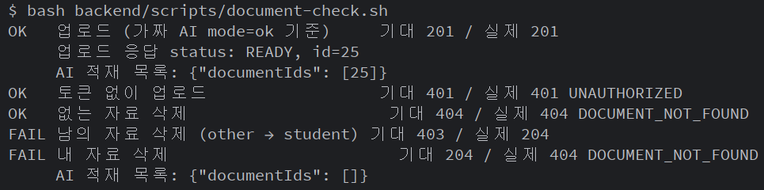
    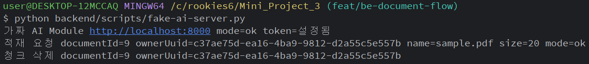

  - 조치 후 — 남의 자료 삭제 403, 감사 로그 기록

    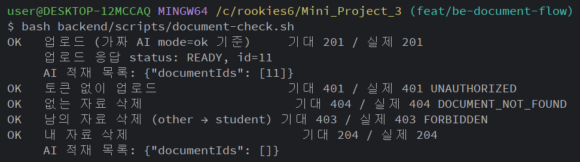
    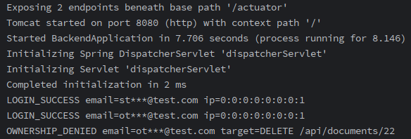

### 6.2 Brute Force — 로그인 시도 횟수 제한 없음

- **관련 항목**: OWASP A07 Identification and Authentication Failures, API Security API2 Broken Authentication / 점검서 B-5
- **커밋**: `feat(be): JWT 필터 · SecurityConfig ...` → `58d50d5 fix(security): 로그인 5회 실패 시 15분 계정 잠금 (Brute Force 조치)`
- **재현 방법** (`bash backend/scripts/bruteforce-check.sh`):
  1. 테스트 계정에 틀린 비밀번호로 10회 연속 로그인
  2. 마지막에 올바른 비밀번호로 로그인
  3. 10회 모두 401, 마지막 로그인 **200** — 횟수 제한 없이 계속 시도 가능
- **영향**: 비밀번호 목록을 자동으로 대입해 계정을 탈취할 수 있음
- **조치 전 코드** (`AuthService.login`):
  ```java
  @Transactional
  public TokenResponse login(LoginRequest request, String ip) {
      String email = normalize(request.email());
      Optional<Member> found = memberRepository.findByEmail(email)
              .filter(m -> passwordEncoder.matches(request.password(), m.getPassword()));
      if (found.isEmpty()) {
          auditLogger.loginFailure(email, ip);
          throw new BusinessException(ErrorCode.INVALID_CREDENTIALS);
      }
      auditLogger.loginSuccess(email, ip);
      return issueTokens(found.get());
  }
  ```
- **조치 후 코드**:
  ```java
  @Transactional(noRollbackFor = BusinessException.class)   // 401 을 던져도 실패 횟수는 저장
  public TokenResponse login(LoginRequest request, String ip) {
      String email = normalize(request.email());
      Member member = memberRepository.findByEmailForUpdate(email).orElse(null); // 행 잠금
      if (member == null) {
          auditLogger.loginFailure(email, ip);
          throw new BusinessException(ErrorCode.INVALID_CREDENTIALS);
      }
      LocalDateTime now = LocalDateTime.now();
      if (member.isLocked(now)) {                       // 잠금 중엔 비밀번호가 맞아도 거부
          auditLogger.accountLocked(email, ip);
          throw locked(member);                         // 423 + lockedUntil
      }
      if (member.getLockedUntil() != null) {
          member.resetLoginFailure();                   // 잠금 시간이 지나면 처음부터 다시 셈
      }
      if (!passwordEncoder.matches(request.password(), member.getPassword())) {
          member.recordLoginFailure(maxAttempts, now.plusMinutes(lockMinutes));
          if (member.isLocked(now)) {
              auditLogger.accountLocked(email, ip);
              throw locked(member);
          }
          auditLogger.loginFailure(email, ip);
          throw new BusinessException(ErrorCode.INVALID_CREDENTIALS);
      }
      member.resetLoginFailure();
      auditLogger.loginSuccess(email, ip);
      return issueTokens(member);
  }
  ```
  - 설정: `auth.login.max-attempts: 5`, `lock-minutes: 15` (`application.yaml`, 환경 변수로 변경 가능)
  - `noRollbackFor`가 없으면 예외로 트랜잭션이 롤백돼 실패 횟수가 저장되지 않고, 행 잠금이 없으면 동시 요청에서 횟수가 누락될 수 있다
- **재확인 결과**: 시도 1\~4 → 401, **시도 5부터 423 `ACCOUNT_LOCKED`**, 올바른 비밀번호도 423 / 감사 로그 `LOGIN_FAILURE` · `ACCOUNT_LOCKED email=br***@test.com`
  - 조치 전 — 10회 실패 후에도 로그인 성공

    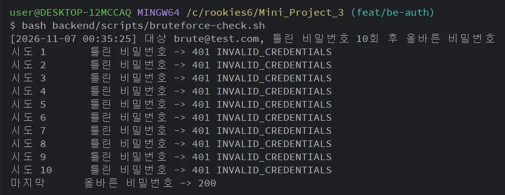

  - 조치 후 — 5회째부터 잠금, 감사 로그 기록

    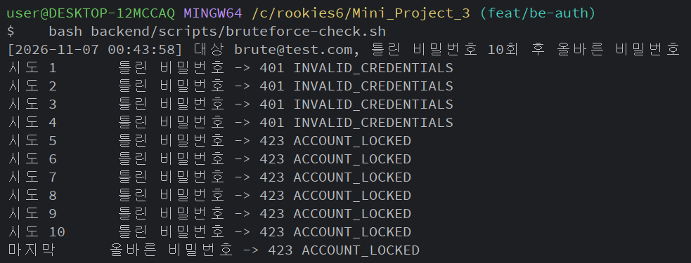
    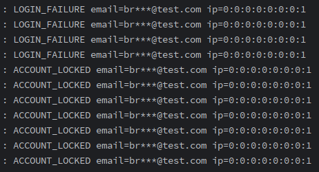

### 6.3 RAG 소유자 우회 — 다른 회원의 자료로 답변받기

- **관련 항목**: OWASP A01 Broken Access Control, LLM Top 10 LLM02 Sensitive Information Disclosure, API Security API1 BOLA / 점검서 B-15
- **커밋**: `feat(be): AI 답변 SSE 중계` → `a6e99d2 fix(security): 질문 검색 소유자를 JWT 회원으로 고정 (RAG 소유자 우회 조치)`
- **재현 방법** (`bash backend/scripts/chat-check.sh`):
  1. student · other가 각각 PDF 업로드 (other는 `other_SECRET.pdf`)
  2. student 토큰으로 `POST /api/chats/stream` 요청, body에 `"ownerUuid": "<other의 uuid>"` 추가
  3. 응답 `sources`에 **`other_SECRET.pdf`** 가 출처로 나오고 그 내용으로 답변 생성 / 가짜 AI 로그에 other의 uuid로 검색된 기록
- **영향**: 다른 학생의 uuid를 알게 되면(로그 · 캡처 · 화면 공유 등으로 노출) 그 학생이 올린 자료 내용을 답변으로 빼낼 수 있음
- **조치 전 코드** (`ChatStreamService.prepare`):
  ```java
  public ChatContext prepare(ChatStreamRequest request) {
      Member member = currentMemberProvider.getCurrentMember();
      Member searchOwner = member;
      if (request.ownerUuid() != null && !request.ownerUuid().isBlank()) {
          searchOwner = memberRepository.findByUuid(request.ownerUuid())   // 요청 값을 그대로 신뢰
                  .orElseThrow(() -> new BusinessException(ErrorCode.INVALID_INPUT));
      }
      List<Long> documentIds = documentRepository.findIdsByMemberIdAndStatus(searchOwner.getId(), DocumentStatus.READY);
      ...
      return new ChatContext(member, request.question().trim(), searchOwner.getUuid(), documentIds);
  }
  ```
- **조치 후 코드**:
  ```java
  public ChatContext prepare(ChatStreamRequest request) {
      Member member = currentMemberProvider.getCurrentMember();          // JWT 회원만
      List<Long> documentIds = documentRepository.findIdsByMemberIdAndStatus(member.getId(), DocumentStatus.READY);
      if (documentIds.isEmpty()) {
          throw new BusinessException(ErrorCode.NO_DOCUMENT);
      }
      return new ChatContext(member, request.question().trim(), member.getUuid(), documentIds);
  }
  ```
  - `ChatStreamRequest`에서 `ownerUuid` 필드 제거 (요청에 넣어도 무시)
- **재확인 결과**: 같은 요청에서 `sources`에 **`student_note.pdf`만** 표시, 가짜 AI 로그의 `ownerUuid`가 student의 uuid
  - 조치 전 — student 토큰으로 other_SECRET.pdf 가 출처로 나옴

    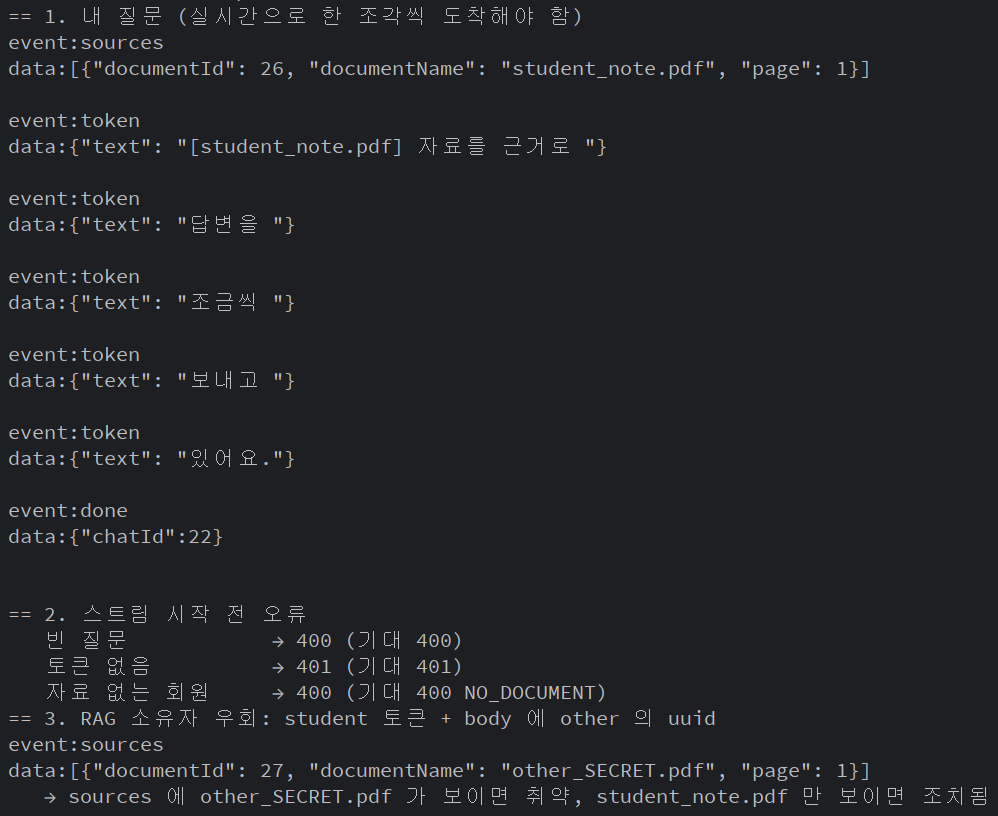

  - 조치 후 — 같은 요청에서 student_note.pdf 만 출처로 나옴

    
- **실제 AI Module 재확인** (`bash backend/scripts/rag-real-check.sh`, 로컬 Compose 전체 기동)
  1. A는 `정보보안학01.pdf`, B는 `3_ReactJS.pdf` 업로드 (실제 적재 → READY)
  2. 대조군: A 본인이 "카이사르 암호는 어떤 방식이야?" 질문 → 출처 `정보보안학01.pdf`, 카이사르 암호 설명 답변
  3. B 토큰으로 같은 질문, body에 A의 `ownerUuid` · `documentIds` 추가 → 출처 `3_ReactJS.pdf`만, "찾지 못했어요" 거절 답변
  - 요청 body의 소유자 · 문서 값이 무시되고, 실제 검색도 JWT 회원의 자료로만 수행됨을 확인

    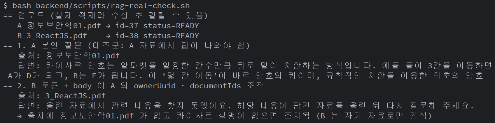

### 6.4 IDOR — 다른 회원의 질문 기록 피드백 수정

- **관련 항목**: OWASP A01 Broken Access Control, API Security API1 BOLA / 점검서 B-2
- **커밋**: `116f3c0 feat(be): 답변 피드백 API` — 6.1(자료 삭제 IDOR) 조치 이후 구현해 **처음부터 소유자 검증을 포함**했다. 같은 취약점이 다시 생기지 않는지 확인하기 위해, 소유자 검증을 제거한 상태로 재현해 효과를 검증했다
- **재현 방법** (`bash backend/scripts/feedback-check.sh`, local 프로필):
  1. student · other 로그인, 각자의 기록 id 확인
  2. student 토큰으로 `PATCH /api/chats/{other의 기록 id}/feedback` — 지금 값과 반대 값 전송
  3. 소유자 검증이 없으면 **200**, other 기록의 피드백이 `None → NOT_HELPFUL`로 바뀜
- **영향**: 기록 id만 바꿔서 다른 학생의 답변 평가를 조작할 수 있음 (id는 순차 증가라 추측 쉬움)
- **조치 전 코드** (소유자 검증 제거 시):
  ```java
  @Transactional
  public ChatFeedbackResponse updateFeedback(Long chatId, Feedback feedback) {
      currentMemberProvider.getCurrentMember();
      ChatHistory chat = chatHistoryRepository.findWithMemberById(chatId)
              .orElseThrow(() -> new BusinessException(ErrorCode.CHAT_NOT_FOUND));
      chat.updateFeedback(feedback);
      return ChatFeedbackResponse.from(chat);
  }
  ```
- **조치 후 코드** (`ChatHistoryService.updateFeedback`):
  ```java
  Member member = currentMemberProvider.getCurrentMember();
  ChatHistory chat = chatHistoryRepository.findWithMemberById(chatId)
          .orElseThrow(() -> new BusinessException(ErrorCode.CHAT_NOT_FOUND));
  if (!chat.isOwnedBy(member.getId())) {
      auditLogger.ownershipDenied(member.getEmail(), "PATCH /api/chats/" + chatId + "/feedback");
      throw new BusinessException(ErrorCode.FORBIDDEN);
  }
  chat.updateFeedback(feedback);
  ```
- **함께 발견 · 조치한 입력값 문제**: 피드백을 enum으로 바로 받으면 JSON 숫자 `0` · `1`이 enum 순번으로 해석돼 `HELPFUL` · `NOT_HELPFUL`로 바뀐다 → 문자열로 받아 `HELPFUL|NOT_HELPFUL`만 허용(`ChatFeedbackRequest`, 그 외 400 `INVALID_INPUT`)
- **재확인 결과**: 남의 기록 피드백 **403 `FORBIDDEN`**, other 기록 값 유지 / 감사 로그 `OWNERSHIP_DENIED email=st***@test.com target=PATCH /api/chats/{id}/feedback` / 내 기록 등록 · 변경 · 멱등 200, 잘못된 값 400, 없는 기록 404, 토큰 없음 401
  - 조치 전 — 남의 기록 피드백 200, 값 변경

    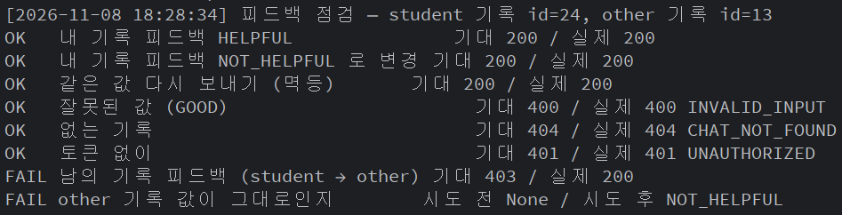

  - 조치 후 — 남의 기록 피드백 403, 값 유지, 감사 로그 기록

    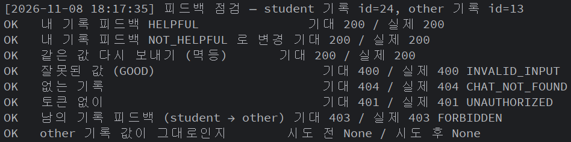
    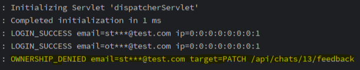

### 6.5 의존성 취약점 — MariaDB JDBC 드라이버 (SBOM 점검)

- **관련 항목**: OWASP A06 Vulnerable and Outdated Components (2025: A03 Software Supply Chain Failures) / 점검서 B-13
- **점검 방법**:
  1. `pom.xml`에 CycloneDX 플러그인 추가 → `./mvnw cyclonedx:makeBom` → `backend/target/bom.json` (CycloneDX 1.6, 런타임 라이브러리 144개)
  2. Trivy로 SBOM 검사: `docker run --rm -v <target 폴더>:/work aquasec/trivy:0.58.1 sbom --scanners vuln /work/bom.json`
- **발견**: 모두 `org.mariadb.jdbc:mariadb-java-client` 3.5.10 (Spring Boot 4.0.9 기본 버전), 수정 버전 3.5.11

| CVE | 심각도 | 내용 |
|------|:--:|------|
| CVE-2026-119210 | MEDIUM | 로컬 파일 검증 우회로 인한 정보 노출 |
| CVE-2026-119276 | MEDIUM | 메모리 할당 제한 없음 → 서비스 거부 |
| CVE-2026-119281 | MEDIUM | 문자셋 변경 검증 없음 → 보안 기능 우회 |
| CVE-2026-119280 | LOW | XA 복구 시 길이 검증 없음 → 서비스 거부 |

- **영향**: DB 드라이버는 Backend와 MariaDB 사이 통신을 담당한다. DB는 내부 네트워크(`db-net`, internal)에만 있어 외부 공격 경로는 제한적이지만, 알려진 취약 버전을 쓰지 않는다
- **조치 전 (`pom.xml`)**: 버전 지정 없음 → Spring Boot 기본값 3.5.10 사용
- **조치 후 (`pom.xml`)**:
  ```xml
  <properties>
      <!-- Boot 4.0.9 기본값 3.5.10 → CVE 4건(MEDIUM 3 · LOW 1) 조치 버전으로 상향 -->
      <mariadb.version>3.5.11</mariadb.version>
  </properties>
  ```
- **재확인 결과**: SBOM 재생성(드라이버 3.5.11) → Trivy 재검사 **취약점 0건**, Backend 기동 · DB 연결 정상, `auth-check.sh` 11개 통과
  - 근거 파일 (`docs/security/`): `sbom-backend-before.json` · `trivy-backend-before.txt` (조치 전) / `sbom-backend-after.json` · `trivy-backend-after.json` (조치 후)

### 6.6 컨테이너 root 실행 — Dockerfile 사용자 미지정

- **관련 항목**: OWASP A02 Security Misconfiguration (2025) / 점검서 I-2 · I-4
- **Issue / 커밋**: #40 → `1e9c03f` backend · `76c0431` ai-module · `7e64373` frontend Dockerfile (`USER` 지정 · `nginx-unprivileged`)
- **재현 방법**: 사용자를 지정하지 않은 베이스 이미지의 실행 사용자 확인
  ```bash
  docker run --rm nginx:alpine id
  docker run --rm python:3.12-slim id
  docker run --rm --entrypoint id eclipse-temurin:17-jre
  ```
  → 3종 모두 `uid=0(root)`

  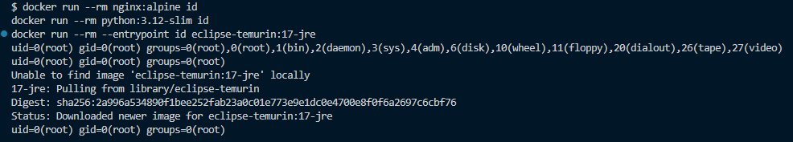
- **영향**: 앱 취약점(RCE 등)으로 컨테이너에 침투하면 root 권한으로 파일 변조 · 패키지 설치가 가능하고, 컨테이너 탈출 시 피해가 커짐
- **조치 전**: Dockerfile에 `USER` 없음 → 베이스 이미지 기본값(root)으로 실행
- **조치 후** (3종 공통: 멀티스테이지 · 비root · HEALTHCHECK):
  ```dockerfile
  # backend/Dockerfile (ai-module 도 같은 방식)
  RUN groupadd --system app && useradd --system --gid app --no-create-home --shell /usr/sbin/nologin app
  COPY --from=build /workspace/app.jar app.jar   # root 소유 → app 은 읽기만 가능
  USER app

  # frontend/Dockerfile
  FROM nginxinc/nginx-unprivileged:alpine         # uid 101, 1024 미만 포트 대신 8080
  ```
  - ai-module 은 Chroma 볼륨 위치(`/data/chroma`)만 `app` 소유로 지정 → 쓰기 가능한 곳을 최소화
  - frontend 컨테이너 포트 80 → 8080 변경에 맞춰 `nginx.conf`, Compose `ports`(`80:8080`) · healthcheck 수정
- **재확인 결과**: `docker compose exec <서비스> id` → backend · ai-service `app`, frontend `uid=101(nginx)` / 4개 서비스 모두 `healthy`

  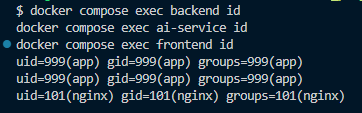
  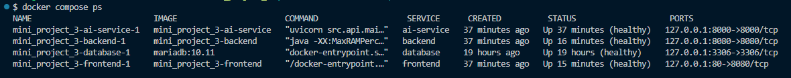
- **이미지 크기 (I-4)**: 빌드 단계 이미지는 실행 이미지에 포함되지 않음

  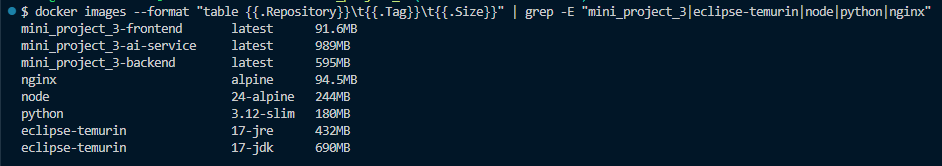

## 7. 잔여 위험 및 향후 과제

| 항목 | 미조치 사유 | 완화 방안 / 향후 계획 |
|------|-------------|------------------------|
| 운영 HTTP(80) 평문 전송 | 시연 환경, 도메인 · 인증서 없음 | 짧은 Access Token · Refresh 회전 / HTTPS(443) 적용 |
| Refresh Token을 sessionStorage에 보관 | HttpOnly 쿠키는 CSRF 보호 · HTTPS가 함께 필요 | CSP, 텍스트 렌더링, 회전 / HttpOnly + Secure 쿠키 전환 |
| 계정 잠금 악용 (남의 계정을 15분 잠금) | 잠금 기능의 부작용 | 자동 해제, 감사 로그 / IP 단위 요청 제한 |
| 자료 id 존재 여부 노출 (남의 자료 403 · 없는 자료 404) | API 설계서 기준(403 · 404 구분) | 소유자 검증으로 접근은 차단 / 필요 시 남의 자료도 404로 통일 |
| AI 청크 삭제 실패 시 Chroma에 청크 잔존 | AI 일시 장애 | 답변은 DB의 READY 문서 id로만 검색해 사용되지 않음 / 주기적 정리 |
| AI 이미지 크기 989MB | chromadb 의존성(onnxruntime 등)이 큼 | 실행 단계에 `.venv` · `src`만 포함 / 사용하지 않는 의존성 정리 |
| 일부 베이스 이미지 태그 미고정 (`node:24-alpine`, `nginx-unprivileged:alpine`, `mariadb:10.11`) | 개발 중 패치 반영 편의 | EC2 배포 전(11/10) 패치 버전까지 고정 |

## 8. 완료 체크리스트

- [ ] 위 5개 영역 점검표 작성 완료 (해당 없음 항목은 사유 기재)
- [x] 취약점 조치 상세 3건 이상 (조치 전/후 코드 포함) — 6.1 \~ 6.6
- [x] 소스코드 · 설정 파일에 API 키 / 비밀번호 / JWT secret 하드코딩 없음 (gitleaks CI 통과)
- [x] SBOM 생성 및 CVE 확인 결과 첨부 (Backend — 6.5, Frontend · AI는 각 담당 점검 후 추가)
- [ ] `npm audit` 결과 첨부
