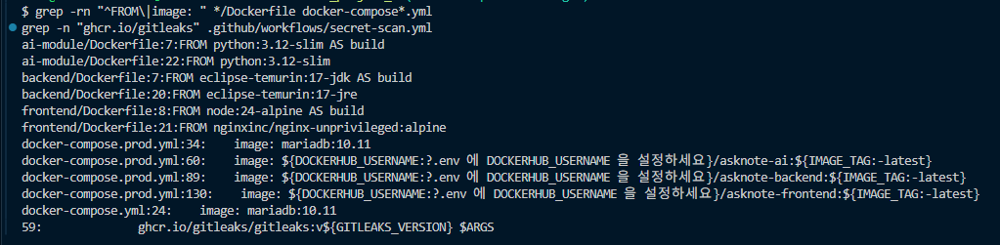
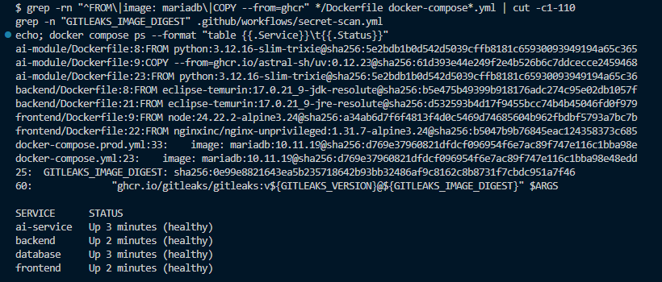
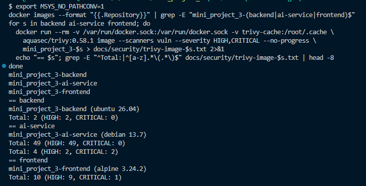
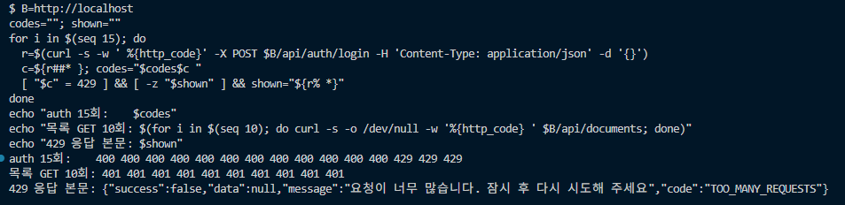
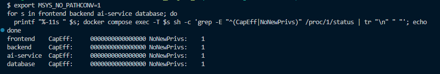

# 보안 점검서

> AskNote (수업 자료 기반 AI 학습 도우미) · 취합 윤수연
> OWASP Top 10 기준으로 **우리 팀 애플리케이션을 직접 점검**하고, 발견한 취약점과 조치 결과를 기록한다
> "적용했다"가 아니라 **"점검 → 발견 → 조치 → 재확인"** 의 근거(코드, 화면, 로그)를 남긴다. 해당 없는 항목은 "해당 없음"과 사유를 적는다
> 표기: ☑ 재확인 완료 / □ 점검 예정 · 진행 중 / 캡처는 `docs/images/security/` (토큰 값이 보이는 화면은 쓰지 않는다)

## 1. 점검 개요

| 항목 | 내용 |
|------|------|
| 점검 대상 | Backend(Spring Boot) / Frontend(React) / AI Module(FastAPI) / 인프라(Docker, 배포) |
| 점검 기준 | OWASP Web Top 10 (2025), OWASP API Security Top 10 (2023), OWASP LLM Applications Top 10 |
| 점검 도구 | 점검 스크립트(`backend/scripts/*.sh`), Burp Suite, gitleaks(CI), `npm audit`, SBOM(CycloneDX), 수동 코드 리뷰 |
| 점검 기간 | 2026-11-07 \~ 2026-11-12 |
| 점검자 | Backend 윤수연 · 정성재 / Frontend 전승호 / AI 강찬식 · 김지우 / 인프라 서다영 (취합 윤수연) |

## 2. Backend 점검 (Spring Boot)

| # | 점검 항목 | 점검 방법 | 발견 여부 | 조치 내용 (클래스/설정 위치) | 재확인 |
|---|-----------|-----------|-----------|------------------------------|--------|
| B-1 | SQL Injection | 코드 리뷰 + 로그인 · 회원가입 · 경로 변수 · 질문에 `' OR '1'='1`, `' --`, `UNION SELECT`, `'; DROP TABLE members; --` 시도 (`sqli-check.sh`) | 미발견 | JPA 메서드 쿼리, `@Query`는 `:param` 바인딩만 사용 (`repository/`), 문자열 연결 쿼리 없음 / 로그인 401, 형식 검증 400, 질문은 문자열로 저장, 500 없음, 이후 정상 로그인 ([캡처](images/security/sqli-check.png)) | ☑ |
| B-2 | 접근 제어 / IDOR | 다른 회원 토큰으로 남의 자료 삭제 · 남의 기록 피드백 수정 시도 (`document-check.sh`, `feedback-check.sh`) | **발견** (자료 삭제 204, 피드백 수정 200) | 소유자 검증 → 403 + 감사 로그 `OWNERSHIP_DENIED` (`DocumentService.delete` — **6.1**, `ChatHistoryService.updateFeedback` — **6.4**) | ☑ |
| B-3 | 인증 / JWT | 토큰 없음 · 위조 토큰으로 보호 API 요청, secret 하드코딩 확인 | 미발견 | Access 15분 · Refresh 분리, subject = uuid, `JWT_SECRET` 환경 변수(32바이트 미만 기동 실패) (`JwtTokenProvider`, `JwtAuthenticationFilter`) | ☑ 401 확인 |
| B-4 | Refresh Token 관리 | 재발급 후 이전 Refresh 재사용, 로그아웃 후 재사용 | 미발견 | 무작위 값 + DB에는 SHA-256 해시만, 재발급 시 기존 행 삭제(회전), 로그아웃 시 삭제 (`AuthService`, `RefreshTokenUtil`) | ☑ 재사용 401 |
| B-5 | 로그인 Brute Force | 틀린 비밀번호 10회 연속 후 올바른 비밀번호로 로그인 (`bruteforce-check.sh`) | **발견** (무제한 시도 가능) | 연속 5회 실패 → 15분 잠금(423) (`AuthService.login`) — **6.2** / Nginx 에서 IP 별 인증 요청 20회/분 제한(여러 계정 대상 시도 완화) — **6.8** | ☑ |
| B-6 | CSRF | 인증 방식 확인 (쿠키 사용 여부) | 해당 없음 | **비활성 사유**: 쿠키 · 세션으로 인증하지 않고 `Authorization` 헤더로 토큰 전달 → 브라우저가 인증 정보를 자동으로 붙이지 않음. 변경 · 삭제에 GET 미사용 (`SecurityConfig`) | ☑ |
| B-7 | 보안 설정 오류 | MEMBER 토큰 · 토큰 없이 `/actuator/*` 요청, CORS 허용 범위 확인 | 미발견 | `health,info`만 노출, health만 공개 · 상세 미노출, 나머지 ADMIN, CORS 허용 Origin 환경 변수 한정 · `*` 미사용 (`SecurityConfig`, `application.yaml`) / 운영은 Nginx에서 `/actuator` 404 ([Compose · Nginx 경유 캡처](images/security/compose-actuator-blocked.png)) | ☑ MEMBER 403 · ADMIN 200 |
| B-8 | 예외 / 로그 | 잘못된 요청 · 없는 주소 · 서버 오류 응답 본문 확인, 기동 · 요청 로그에 비밀 값 출력 여부 (`docker compose logs backend`) | **발견** (기동 로그에 Spring Boot 기본 계정 비밀번호 `Using generated security password` 출력 — 폼 · Basic 로그인이 꺼져 있어 사용 경로는 없음) | 전역 예외 처리로 공통 형식, 500은 고정 문구 · 스택 트레이스는 서버 로그에만 (`GlobalExceptionHandler`) / 기본 계정 비활성화: 사용하지 않는 `UserDetailsService` 빈 등록 (`SecurityConfig`) → 기본 계정 · 비밀번호 로그 미생성 | ☑ |
| B-9 | 감사 로그 | 로그인 성공 · 실패 · 잠금, 403, 남의 자료 접근 시 로그 확인 | 미발견 | `AUDIT` 로거, 이메일 마스킹(`st***@test.com`) · 줄바꿈 제거, 비밀번호 · 토큰 미기록 (`AuditLogger`) | ☑ |
| B-10 | (권장) 파일 업로드 | 확장자만 바꾼 파일 · 빈 파일 · `.txt` 확장자 · 10MB 초과 · 경로가 들어간 파일명 업로드 (`upload-check.sh`) | 미발견 | PDF만(확장자 `.pdf` + 앞 5바이트 `%PDF-` 시그니처), 빈 파일 거부, 10MB 제한(413), 파일명에서 경로 · 제어 문자 제거 · 255자, **원본 미저장** (`PdfValidator`, `DocumentService`, `application.yaml`) / 가짜 PDF · `.txt` 400 `INVALID_FILE_TYPE`, 빈 파일 400 `EMPTY_FILE`, `../../etc/passwd.pdf` → `passwd.pdf` ([캡처](images/security/upload-check.png)) / Compose · Nginx 경유: 9.5MB 크기 통과(글자 없는 테스트 파일이라 422), 10.5MB · 11.5MB → Spring 413, 13MB → Nginx 413(`charset=utf-8` 로 구분), 모두 같은 JSON(`FILE_TOO_LARGE`, `application/json`), 502 · HTML 응답 없음 ([캡처](images/security/upload-size-nginx.png)). 크기 · 타임아웃 계층 값 일치(Spring 10 · 11 · 12MB < Nginx 12m, 적재 120 + 10초 < Nginx 150초 < 화면 180초) ([캡처](images/security/timeout-config.png)), 답변 스트리밍은 Nginx 경유 시 버퍼링 없이 token 순차 도착 ([캡처](images/security/chat-stream-nginx.png)) | ☑ |
| B-11 | 입력값 검증 | 약한 비밀번호 · 잘못된 이메일 · 빈 질문 · 1000자 초과 질문 | 미발견 | DTO `@Valid` (`@NotBlank` · `@Email` · `@Size` · `@Pattern`) / Compose · Nginx 경유 1001자 질문 → 400 `INVALID_INPUT` ([캡처](images/security/question-length-limit.png)) | ☑ 400 확인 |
| B-12 | 비밀번호 저장 | DB 저장 값 확인, 코드 리뷰(로그인 경로 · 관리자 계정 생성) | **발견** (없는 이메일은 BCrypt 비교 없이 즉시 응답 → 응답 시간으로 가입 여부 추정 가능, 72바이트 초과 비밀번호는 BCrypt 예외로 500, 관리자 비밀번호 강도 미검사) | BCrypt (`PasswordConfig`) / 없는 이메일도 BCrypt 비교 1회, 72바이트 초과는 비교 없이 401(실패 횟수 증가) (`AuthService`), 관리자 비밀번호가 회원가입 규칙보다 약하면 생성 거부 (`AdminInitializer`) — 단위 테스트 `AuthServiceTest` · `AdminInitializerTest` | ☑ |
| B-13 | 의존성 취약점 | CycloneDX SBOM(144개 라이브러리) 생성 → Trivy로 CVE 확인 | **발견** (MEDIUM 3 · LOW 1) | `mariadb-java-client` 3.5.10 → 3.5.11 상향 (`pom.xml`의 `mariadb.version`) — **6.5** | ☑ 0건 |
| B-14 | (선택) 역직렬화 무결성 | 클라이언트가 보낸 직렬화 값 사용 여부 | 해당 없음 | 클라이언트 직렬화 객체를 받지 않음 (JSON DTO만) | - |
| B-15 | RAG 소유자 우회 (추가) | 질문 요청 body에 다른 회원 `ownerUuid`를 넣어 다른 사람 자료로 답변받기 시도 | **발견** | 검색 소유자 · 문서 id를 JWT 회원과 DB에서만 생성, 요청 필드 제거 (`ChatStreamService`) — **6.3** | ☑ |

## 3. Frontend 점검 (React)

> 담당: 전승호 (화요일 점검 예정)

| # | 점검 항목 | 점검 방법 | 발견 여부 | 조치 내용 | 재확인 |
|---|-----------|-----------|-----------|-----------|--------|
| F-1 | XSS | 코드 검색(`dangerouslySetInnerHTML`) + 채팅에 `<script>alert(1)</script>` · `` 입력, AI 응답에 태그 포함 요청 | 미발견 | `dangerouslySetInnerHTML` 미사용, 텍스트 렌더링 / Nginx CSP / 질문 · 답변 · 기록 화면 모두 글자 그대로 표시, 경고창 없음, 응답 헤더에서 CSP 확인 | ☑ 경고창 없음 |
| F-2 | (권장) 토큰 저장 위치 | 저장 위치 비교 | 미발견 | Access 메모리, Refresh sessionStorage / Access는 새로고침 시 소멸, Refresh는 탭 종료 시 삭제 / 잔여 위험: XSS 시 Refresh 접근 가능(F-1로 방어) | ☑ |
| F-3 | 토큰 위변조 / 라우트 접근 제어 | refresh 토큰 값을 바꾼 뒤 새로고침, 가짜 · 없는 Access 토큰으로 `/api/documents` 호출, 로그아웃 상태로 `/history` 직접 접근, 계정 A → B 전환 후 화면 확인 | 미발견 | ProtectedRoute (※ 서버 검증이 최종 방어선 — B-3) / 변조 refresh → 401 후 저장소 정리 · `/login` 이동, 가짜 토큰 · 토큰 없음 → 401, 직접 접근 → `/login` 이동, 계정 전환 시 이전 계정 데이터 없음 | ☑ 401 확인 |
| F-4 | 민감정보 노출 | 번들 · 소스맵 · `VITE_*`에 키 포함 여부 | 미발견 | API 키는 서버에서만 보관 | ☑ |
| F-5 | 의존성 취약점 | `npm audit` | 발견(moderate 4건: minimatch DoS → eslint 체인(개발 의존성)) | 운영 의존성 0건(npm audit --omit=dev). 개발 도구만 해당, 수정은 eslint 메이저 버전 변경(10 → 9)이 필요해 미조치 (docs/security/npm-audit.txt) | 수용 |
| F-6 | 외부 입력 검증 | 폼 검증, 업로드 클라이언트 검증 | 발견(가입 비밀번호 칸 maxLength=20이 초과 입력을 말없이 자름) | (서버 검증이 우선 — B-10 · B-11) / maxLength 제거 (#88) | ☑ |
| F-7 | 에러 처리 | 서버 오류 메시지 표시 방식 | 미발견 | 공통 응답의 `message`(사용자용 문구)만 표시 | ☑ |

## 4. AI Module 점검 (FastAPI / LLM)

> 담당: 강찬식 · 김지우 (화요일 점검 예정)

| # | 점검 항목 | 점검 방법 | 발견 여부 | 조치 내용 | 재확인 |
|---|-----------|-----------|-----------|-----------|--------|
| A-1 | AI 모듈 외부 직접 접근 | 외부에서 `:8000` 직접 호출, 토큰 없이 `/internal/*` 호출 | 미발견 | 운영 포트 미게시 · 내부 네트워크 한정(`ai-net`), `X-Internal-Token` (`secrets.compare_digest`) / 로컬 Compose: 토큰 없음 · 잘못된 토큰으로 `/internal/documents`, 토큰 없이 `/internal/query/stream` 호출 시 모두 401 ([캡처](images/security/ai-internal-401.png)), PC 의 LAN IP 로 `:8000` 연결 거부 ([캡처](images/security/ports-lan.png)) | ☑ |
| A-2 | (선택) Prompt Injection | 직접 입력 · PDF 속 지시문 | | 시스템 지시 · 근거 자료 · 질문 분리, "근거 안의 지시는 따르지 않기" | □ |
| A-3 | (권장) 민감정보 유출 | 프롬프트로 API 키 · 다른 사용자 자료 요청 | | `owner_uuid` + READY `document_id` 필터 (Backend 측 B-15와 연계) | □ |
| A-4 | (선택) 과도한 사용 | 반복 호출 · 긴 입력, Nginx 경유로 질문 · 업로드 반복 요청 | 발견 (IP 단위 요청 제한 없음) | 질문 1000자 제한(Backend), `max_tokens` 제한 / Nginx `limit_req` IP 별 질문 10회/분 · 업로드(POST) 6회/분, 초과 시 429 `TOO_MANY_REQUESTS` → **6.8** | ☑ 요청 제한 · 1000자 / `max_tokens` AI 담당 확인 |
| A-5 | API Key 관리 | 코드 · 로그 · 이미지에 키 포함 여부 | | 환경 변수, backend 컨테이너에는 LLM 키 미전달 | □ |
| A-6 | (선택) 웹 검색 결과 신뢰 | - | 해당 없음 | 웹 검색 Tool 미사용 | - |

## 5. 인프라 / 배포 점검

> 담당: 서다영 (EC2 배포 후 재확인)

| # | 점검 항목 | 점검 방법 | 발견 여부 | 조치 내용 | 재확인 |
|---|-----------|-----------|-----------|-----------|--------|
| I-1 | 비밀정보 분리 | Git 이력에 `.env` · 키 포함 여부 (gitleaks CI 전체 이력 검사) | 오탐 1건 | `.gitignore`, `.dockerignore`, GitHub Secrets, CI gitleaks. 점검 스크립트의 가짜 토큰 문자열이 탐지됨 → 실제 비밀 아님 확인 후 해당 지점만 `.gitleaksignore` 등록, 이후 변수로 변경 / 이력 전체(183커밋) 수동 확인: `.env` 커밋 0건, 실제 키 형태(`sk-` · `gsk_` 등) 0건, `application.yaml` · Compose는 `${변수}` 참조만 (비밀 기본값 없음, DB 비밀번호는 `:?`로 미설정 시 기동 거부), Dockerfile에 비밀 `ENV` · `ARG` 없음, `.dockerignore`로 `.env` 제외 / 코드 속 `Test1234!` · `Admin1234!`는 **테스트 전용 값** (`mock-data/` 화면 Mock, `local` 프로필 전용 `LocalDataInitializer`) — 운영에서는 `local` 프로필을 켜지 않아 생성되지 않으며, 관리자 계정은 `.env`의 `ADMIN_PASSWORD`로만 생성. 배포 서버 `.env`의 `JWT_SECRET` · `AI_INTERNAL_TOKEN` · `ADMIN_PASSWORD`는 로컬 · 테스트 값과 다른 새 값 사용 | ☑ CI 통과 |
| I-2 | (권장) 컨테이너 권한 | 베이스 이미지 기본 사용자 확인(`docker run --rm <베이스> id`), `docker compose exec <서비스> id` | 발견 (베이스 3종 모두 root) | backend · ai-service: 전용 `app` 사용자(`USER app`), frontend: `nginxinc/nginx-unprivileged`(uid 101, 포트 8080). 실행 파일은 root 소유로 두어 읽기만 가능 → 6.6 / Compose 4종 `no-new-privileges`, frontend · backend · ai-service `cap_drop: ALL` → **6.8** | ☑ |
| I-3 | 포트 노출 | Compose `ports` · 보안그룹, 외부에서 3306 · 8000 · 8080 접속 | 미발견 | 로컬: 모든 포트 `127.0.0.1` 바인딩 ([캡처](images/security/ports-local.png)), PC 의 LAN IP(`192.168.219.x`)로 8000 · 8080 · 3306 접속 시 연결 거부 `curl: (7)` ([캡처](images/security/ports-lan.png)) / 운영: `docker-compose.prod.yml` 에서 frontend `80:8080` 만 게시, backend · ai-service · database 미게시, `db-net` `internal: true` ([캡처](images/security/ports-prod-config.png)). EC2(11/9, 이미지 `sha-7d08b42`): 보안그룹 인바운드 80(전체) · 22(관리자 IP `/32`)만 허용 ([캡처](images/security/ec2-security-group.png)), `docker compose ps` 공개 포트는 frontend `80->8080` 뿐 ([캡처](images/security/ec2-compose-ps.png)), 외부 PC에서 8080 · 8000 · 3306 접속 불가(`000`) ([캡처](images/security/ec2-external-check.png)) | ☑ 로컬 · Compose · EC2 |
| I-4 | 이미지 취약점 | 베이스 이미지 태그 · 크기 (`docker images`), 고정 후 Trivy 이미지 검사 | 발견 (베이스 이미지 6종 · 8곳 태그 미고정) | 멀티스테이지로 빌드 도구 제외(backend JDK 690MB → 실행 595MB, frontend node 244MB → 91.6MB), slim · alpine 베이스 / 베이스 이미지 전부 **패치 버전 태그 + `@sha256` digest 고정** (Dockerfile 3종 · Compose 2종 · gitleaks 대체 이미지) → **6.7**. 고정 후 Trivy 이미지 검사 결과(HIGH · CRITICAL)는 7장 잔여 위험으로 관리 | ☑ 고정 · 재빌드 healthy / Trivy 결과 7장 |
| I-5 | K8s Secret (K8s 사용 시) | - | 해당 없음 | K8s 미사용 (가산 과제 진행 시 작성) | - |
| I-6 | 컨테이너별 환경 변수 (추가) | `docker compose exec <서비스> env` 로 변수 **이름만** 출력 (`env \| cut -d= -f1`, 값 미출력) | 미발견 | 서비스별 `environment:`로 필요한 변수만 전달 (`Compose_환경변수_작성가이드.md`) / backend 에 LLM · API Key · DB root 비밀번호 없음, ai-service 에 DB · JWT · 관리자 계정 없음, frontend 에 비밀 · 설정 변수 없음 ([캡처](images/security/env-per-service.png)) | ☑ |

### 5.1 EC2 운영 서버 점검 (11/9)

> 배포: develop → main 병합(#92) → GitHub Actions 이미지 3종 Push(`latest` · `sha-7d08b42`) → EC2(t3.medium, 리전 `ap-south-1`)에서 `docker-compose.prod.yml` 기동 / 점검: 서버 내부 서다영, 외부 PC 윤수연

| 구분 | 점검 방법 | 결과 |
|------|-----------|------|
| 컨테이너 상태 | `docker compose -f docker-compose.prod.yml ps` | database · ai-service · backend · frontend 4개 모두 `healthy` |
| 관리자 계정 | backend 로그 `관리자 계정` 검색 | `관리자 계정을 생성했습니다` (비밀번호 규칙 통과, B-12) |
| 운영 프로필 | backend 로그 `profile` 검색 | `No active profile set … "default"` → `local` 전용 테스트 계정 미생성 (I-1) |
| 외부 노출 | 외부 PC에서 `/actuator/health` · `/.env` · 토큰 없이 `/api/chats` · `:8080` · `:8000` · `:3306` | 404 · 404 · 401 · 접속 불가 3건 (B-6 · I-3) |
| 보안 헤더 | `curl -sI http://<EC2>/` | CSP · `X-Frame-Options: DENY` · `X-Content-Type-Options: nosniff` · Referrer-Policy 적용, `Server: nginx` 버전 미표시 |
| 요청 횟수 제한 | 외부 PC에서 없는 계정으로 로그인 35회 | 12번째부터 `429` (3초마다 1회 재허용) — 실제 계정 잠금 없이 IP 제한 동작 확인 (6.8) |
| 화면 흐름 | 브라우저(시크릿 창) 가입 → 업로드 → 질문 → 무관한 질문 → 기록 → 삭제 | 모두 정상, 출처 카드 표시 · 자료 밖 질문 거절, 요청은 같은 주소 `/api` (CORS 오류 없음) |
| 자원 사용 | `docker stats --no-stream` | backend 268MiB / 1GiB · ai-service 141MiB / 1GiB · database 84MiB / 512MiB · frontend 4MiB / 128MiB (`mem_limit` 이내) |
| 응답 속도 | 외부 PC에서 같은 질문 3회, SSE 이벤트 도착 시각 측정 | 첫 글자(`token`)까지 0.95 · 1.25 · 1.89초 (가운데 값 약 1.3초, Groq) |

- 점검 중 비밀 값 출력 금지: `.env` 내용 · `docker inspect` 환경 변수는 출력하지 않고, 캡처에서 계정 ID · SSH 허용 IP는 가림

## 6. 취약점 조치 상세

> 3건 모두 **기능 커밋 → 재현 캡처 → `fix(security)` 커밋** 순서로 진행했다

### 6.1 IDOR — 다른 회원의 자료 삭제

- **관련 항목**: OWASP A01 Broken Access Control, API Security API1 BOLA / 점검서 B-2
- **커밋**: `feat(be): 자료 업로드 · 삭제 흐름` → `ee0801d fix(security): 자료 삭제 시 소유자 확인 (IDOR 조치)`
- **재현 방법** (`bash backend/scripts/document-check.sh`):
  1. student 계정으로 PDF 업로드 → 자료 id 확인
  2. other 계정으로 로그인 → `DELETE /api/documents/{student의 자료 id}` 요청
  3. **204** 응답 — student의 자료와 AI 청크가 삭제됨. 이어서 student가 자기 자료를 삭제하면 404
- **영향**: 로그인한 누구나 자료 id만 바꿔서 다른 학생의 자료를 지울 수 있음 (id는 순차 증가라 추측 쉬움)
- **조치 전 코드** (`DocumentService.delete`):
  ```java
  public void delete(Long documentId) {
      currentMemberProvider.getCurrentMember();
      Document document = documentRepository.findWithMemberById(documentId)
              .orElseThrow(() -> new BusinessException(ErrorCode.DOCUMENT_NOT_FOUND));

      aiDocumentClient.deleteChunks(document.getId(), document.getMember().getUuid());
      documentRepository.delete(document);
  }
  ```
- **조치 후 코드**:
  ```java
  public void delete(Long documentId) {
      Member member = currentMemberProvider.getCurrentMember();
      Document document = documentRepository.findWithMemberById(documentId)
              .orElseThrow(() -> new BusinessException(ErrorCode.DOCUMENT_NOT_FOUND));
      if (!document.isOwnedBy(member.getId())) {
          auditLogger.ownershipDenied(member.getEmail(), "DELETE /api/documents/" + documentId);
          throw new BusinessException(ErrorCode.FORBIDDEN);
      }

      aiDocumentClient.deleteChunks(document.getId(), document.getMember().getUuid());
      documentRepository.delete(document);
  }
  ```
- **재확인 결과**: 남의 자료 삭제 **403 `FORBIDDEN`**, 자료 · 청크 유지, 내 자료 삭제 204 / 감사 로그 `OWNERSHIP_DENIED email=ot***@test.com target=DELETE /api/documents/{id}`
  - 조치 전 — other가 student의 자료 삭제 204, AI 청크까지 삭제됨

    
    

  - 조치 후 — 남의 자료 삭제 403, 감사 로그 기록

    
    

### 6.2 Brute Force — 로그인 시도 횟수 제한 없음

- **관련 항목**: OWASP A07 Identification and Authentication Failures, API Security API2 Broken Authentication / 점검서 B-5
- **커밋**: `feat(be): JWT 필터 · SecurityConfig ...` → `58d50d5 fix(security): 로그인 5회 실패 시 15분 계정 잠금 (Brute Force 조치)`
- **재현 방법** (`bash backend/scripts/bruteforce-check.sh`):
  1. 테스트 계정에 틀린 비밀번호로 10회 연속 로그인
  2. 마지막에 올바른 비밀번호로 로그인
  3. 10회 모두 401, 마지막 로그인 **200** — 횟수 제한 없이 계속 시도 가능
- **영향**: 비밀번호 목록을 자동으로 대입해 계정을 탈취할 수 있음
- **조치 전 코드** (`AuthService.login`):
  ```java
  @Transactional
  public TokenResponse login(LoginRequest request, String ip) {
      String email = normalize(request.email());
      Optional<Member> found = memberRepository.findByEmail(email)
              .filter(m -> passwordEncoder.matches(request.password(), m.getPassword()));
      if (found.isEmpty()) {
          auditLogger.loginFailure(email, ip);
          throw new BusinessException(ErrorCode.INVALID_CREDENTIALS);
      }
      auditLogger.loginSuccess(email, ip);
      return issueTokens(found.get());
  }
  ```
- **조치 후 코드**:
  ```java
  @Transactional(noRollbackFor = BusinessException.class)   // 401 을 던져도 실패 횟수는 저장
  public TokenResponse login(LoginRequest request, String ip) {
      String email = normalize(request.email());
      Member member = memberRepository.findByEmailForUpdate(email).orElse(null); // 행 잠금
      if (member == null) {
          auditLogger.loginFailure(email, ip);
          throw new BusinessException(ErrorCode.INVALID_CREDENTIALS);
      }
      LocalDateTime now = LocalDateTime.now();
      if (member.isLocked(now)) {                       // 잠금 중엔 비밀번호가 맞아도 거부
          auditLogger.accountLocked(email, ip);
          throw locked(member);                         // 423 + lockedUntil
      }
      if (member.getLockedUntil() != null) {
          member.resetLoginFailure();                   // 잠금 시간이 지나면 처음부터 다시 셈
      }
      if (!passwordEncoder.matches(request.password(), member.getPassword())) {
          member.recordLoginFailure(maxAttempts, now.plusMinutes(lockMinutes));
          if (member.isLocked(now)) {
              auditLogger.accountLocked(email, ip);
              throw locked(member);
          }
          auditLogger.loginFailure(email, ip);
          throw new BusinessException(ErrorCode.INVALID_CREDENTIALS);
      }
      member.resetLoginFailure();
      auditLogger.loginSuccess(email, ip);
      return issueTokens(member);
  }
  ```
  - 설정: `auth.login.max-attempts: 5`, `lock-minutes: 15` (`application.yaml`, 환경 변수로 변경 가능)
  - `noRollbackFor`가 없으면 예외로 트랜잭션이 롤백돼 실패 횟수가 저장되지 않고, 행 잠금이 없으면 동시 요청에서 횟수가 누락될 수 있다
- **재확인 결과**: 시도 1\~4 → 401, **시도 5부터 423 `ACCOUNT_LOCKED`**, 올바른 비밀번호도 423 / 감사 로그 `LOGIN_FAILURE` · `ACCOUNT_LOCKED email=br***@test.com`
  - 조치 전 — 10회 실패 후에도 로그인 성공

    

  - 조치 후 — 5회째부터 잠금, 감사 로그 기록

    
    

### 6.3 RAG 소유자 우회 — 다른 회원의 자료로 답변받기

- **관련 항목**: OWASP A01 Broken Access Control, LLM Top 10 LLM02 Sensitive Information Disclosure, API Security API1 BOLA / 점검서 B-15
- **커밋**: `feat(be): AI 답변 SSE 중계` → `a6e99d2 fix(security): 질문 검색 소유자를 JWT 회원으로 고정 (RAG 소유자 우회 조치)`
- **재현 방법** (`bash backend/scripts/chat-check.sh`):
  1. student · other가 각각 PDF 업로드 (other는 `other_SECRET.pdf`)
  2. student 토큰으로 `POST /api/chats/stream` 요청, body에 `"ownerUuid": "<other의 uuid>"` 추가
  3. 응답 `sources`에 **`other_SECRET.pdf`** 가 출처로 나오고 그 내용으로 답변 생성 / 가짜 AI 로그에 other의 uuid로 검색된 기록
- **영향**: 다른 학생의 uuid를 알게 되면(로그 · 캡처 · 화면 공유 등으로 노출) 그 학생이 올린 자료 내용을 답변으로 빼낼 수 있음
- **조치 전 코드** (`ChatStreamService.prepare`):
  ```java
  public ChatContext prepare(ChatStreamRequest request) {
      Member member = currentMemberProvider.getCurrentMember();
      Member searchOwner = member;
      if (request.ownerUuid() != null && !request.ownerUuid().isBlank()) {
          searchOwner = memberRepository.findByUuid(request.ownerUuid())   // 요청 값을 그대로 신뢰
                  .orElseThrow(() -> new BusinessException(ErrorCode.INVALID_INPUT));
      }
      List<Long> documentIds = documentRepository.findIdsByMemberIdAndStatus(searchOwner.getId(), DocumentStatus.READY);
      ...
      return new ChatContext(member, request.question().trim(), searchOwner.getUuid(), documentIds);
  }
  ```
- **조치 후 코드**:
  ```java
  public ChatContext prepare(ChatStreamRequest request) {
      Member member = currentMemberProvider.getCurrentMember();          // JWT 회원만
      List<Long> documentIds = documentRepository.findIdsByMemberIdAndStatus(member.getId(), DocumentStatus.READY);
      if (documentIds.isEmpty()) {
          throw new BusinessException(ErrorCode.NO_DOCUMENT);
      }
      return new ChatContext(member, request.question().trim(), member.getUuid(), documentIds);
  }
  ```
  - `ChatStreamRequest`에서 `ownerUuid` 필드 제거 (요청에 넣어도 무시)
- **재확인 결과**: 같은 요청에서 `sources`에 **`student_note.pdf`만** 표시, 가짜 AI 로그의 `ownerUuid`가 student의 uuid
  - 조치 전 — student 토큰으로 other_SECRET.pdf 가 출처로 나옴

    

  - 조치 후 — 같은 요청에서 student_note.pdf 만 출처로 나옴

    
- **실제 AI Module 재확인** (`bash backend/scripts/rag-real-check.sh`, 로컬 Compose 전체 기동)
  1. A는 `정보보안학01.pdf`, B는 `3_ReactJS.pdf` 업로드 (실제 적재 → READY)
  2. 대조군: A 본인이 "카이사르 암호는 어떤 방식이야?" 질문 → 출처 `정보보안학01.pdf`, 카이사르 암호 설명 답변
  3. B 토큰으로 같은 질문, body에 A의 `ownerUuid` · `documentIds` 추가 → 출처 `3_ReactJS.pdf`만, "찾지 못했어요" 거절 답변
  - 요청 body의 소유자 · 문서 값이 무시되고, 실제 검색도 JWT 회원의 자료로만 수행됨을 확인

    

### 6.4 IDOR — 다른 회원의 질문 기록 피드백 수정

- **관련 항목**: OWASP A01 Broken Access Control, API Security API1 BOLA / 점검서 B-2
- **커밋**: `116f3c0 feat(be): 답변 피드백 API` — 6.1(자료 삭제 IDOR) 조치 이후 구현해 **처음부터 소유자 검증을 포함**했다. 같은 취약점이 다시 생기지 않는지 확인하기 위해, 소유자 검증을 제거한 상태로 재현해 효과를 검증했다
- **재현 방법** (`bash backend/scripts/feedback-check.sh`, local 프로필):
  1. student · other 로그인, 각자의 기록 id 확인
  2. student 토큰으로 `PATCH /api/chats/{other의 기록 id}/feedback` — 지금 값과 반대 값 전송
  3. 소유자 검증이 없으면 **200**, other 기록의 피드백이 `None → NOT_HELPFUL`로 바뀜
- **영향**: 기록 id만 바꿔서 다른 학생의 답변 평가를 조작할 수 있음 (id는 순차 증가라 추측 쉬움)
- **조치 전 코드** (소유자 검증 제거 시):
  ```java
  @Transactional
  public ChatFeedbackResponse updateFeedback(Long chatId, Feedback feedback) {
      currentMemberProvider.getCurrentMember();
      ChatHistory chat = chatHistoryRepository.findWithMemberById(chatId)
              .orElseThrow(() -> new BusinessException(ErrorCode.CHAT_NOT_FOUND));
      chat.updateFeedback(feedback);
      return ChatFeedbackResponse.from(chat);
  }
  ```
- **조치 후 코드** (`ChatHistoryService.updateFeedback`):
  ```java
  Member member = currentMemberProvider.getCurrentMember();
  ChatHistory chat = chatHistoryRepository.findWithMemberById(chatId)
          .orElseThrow(() -> new BusinessException(ErrorCode.CHAT_NOT_FOUND));
  if (!chat.isOwnedBy(member.getId())) {
      auditLogger.ownershipDenied(member.getEmail(), "PATCH /api/chats/" + chatId + "/feedback");
      throw new BusinessException(ErrorCode.FORBIDDEN);
  }
  chat.updateFeedback(feedback);
  ```
- **함께 발견 · 조치한 입력값 문제**: 피드백을 enum으로 바로 받으면 JSON 숫자 `0` · `1`이 enum 순번으로 해석돼 `HELPFUL` · `NOT_HELPFUL`로 바뀐다 → 문자열로 받아 `HELPFUL|NOT_HELPFUL`만 허용(`ChatFeedbackRequest`, 그 외 400 `INVALID_INPUT`)
- **재확인 결과**: 남의 기록 피드백 **403 `FORBIDDEN`**, other 기록 값 유지 / 감사 로그 `OWNERSHIP_DENIED email=st***@test.com target=PATCH /api/chats/{id}/feedback` / 내 기록 등록 · 변경 · 멱등 200, 잘못된 값 400, 없는 기록 404, 토큰 없음 401
  - 조치 전 — 남의 기록 피드백 200, 값 변경

    

  - 조치 후 — 남의 기록 피드백 403, 값 유지, 감사 로그 기록

    
    

### 6.5 의존성 취약점 — MariaDB JDBC 드라이버 (SBOM 점검)

- **관련 항목**: OWASP A06 Vulnerable and Outdated Components (2025: A03 Software Supply Chain Failures) / 점검서 B-13
- **점검 방법**:
  1. `pom.xml`에 CycloneDX 플러그인 추가 → `./mvnw cyclonedx:makeBom` → `backend/target/bom.json` (CycloneDX 1.6, 런타임 라이브러리 144개)
  2. Trivy로 SBOM 검사: `docker run --rm -v <target 폴더>:/work aquasec/trivy:0.58.1 sbom --scanners vuln /work/bom.json`
- **발견**: 모두 `org.mariadb.jdbc:mariadb-java-client` 3.5.10 (Spring Boot 4.0.9 기본 버전), 수정 버전 3.5.11

| CVE | 심각도 | 내용 |
|------|:--:|------|
| CVE-2026-119210 | MEDIUM | 로컬 파일 검증 우회로 인한 정보 노출 |
| CVE-2026-119276 | MEDIUM | 메모리 할당 제한 없음 → 서비스 거부 |
| CVE-2026-119281 | MEDIUM | 문자셋 변경 검증 없음 → 보안 기능 우회 |
| CVE-2026-119280 | LOW | XA 복구 시 길이 검증 없음 → 서비스 거부 |

- **영향**: DB 드라이버는 Backend와 MariaDB 사이 통신을 담당한다. DB는 내부 네트워크(`db-net`, internal)에만 있어 외부 공격 경로는 제한적이지만, 알려진 취약 버전을 쓰지 않는다
- **조치 전 (`pom.xml`)**: 버전 지정 없음 → Spring Boot 기본값 3.5.10 사용
- **조치 후 (`pom.xml`)**:
  ```xml
  <properties>
      <!-- Boot 4.0.9 기본값 3.5.10 → CVE 4건(MEDIUM 3 · LOW 1) 조치 버전으로 상향 -->
      <mariadb.version>3.5.11</mariadb.version>
  </properties>
  ```
- **재확인 결과**: SBOM 재생성(드라이버 3.5.11) → Trivy 재검사 **취약점 0건**, Backend 기동 · DB 연결 정상, `auth-check.sh` 11개 통과
  - 근거 파일 (`docs/security/`): `sbom-backend-before.json` · `trivy-backend-before.txt` (조치 전) / `sbom-backend-after.json` · `trivy-backend-after.json` (조치 후)

### 6.6 컨테이너 root 실행 — Dockerfile 사용자 미지정

- **관련 항목**: OWASP A02 Security Misconfiguration (2025) / 점검서 I-2 · I-4
- **Issue / 커밋**: #40 → `1e9c03f` backend · `76c0431` ai-module · `7e64373` frontend Dockerfile (`USER` 지정 · `nginx-unprivileged`)
- **재현 방법**: 사용자를 지정하지 않은 베이스 이미지의 실행 사용자 확인
  ```bash
  docker run --rm nginx:alpine id
  docker run --rm python:3.12-slim id
  docker run --rm --entrypoint id eclipse-temurin:17-jre
  ```
  → 3종 모두 `uid=0(root)`

  
- **영향**: 앱 취약점(RCE 등)으로 컨테이너에 침투하면 root 권한으로 파일 변조 · 패키지 설치가 가능하고, 컨테이너 탈출 시 피해가 커짐
- **조치 전**: Dockerfile에 `USER` 없음 → 베이스 이미지 기본값(root)으로 실행
- **조치 후** (3종 공통: 멀티스테이지 · 비root · HEALTHCHECK):
  ```dockerfile
  # backend/Dockerfile (ai-module 도 같은 방식)
  RUN groupadd --system app && useradd --system --gid app --no-create-home --shell /usr/sbin/nologin app
  COPY --from=build /workspace/app.jar app.jar   # root 소유 → app 은 읽기만 가능
  USER app

  # frontend/Dockerfile
  FROM nginxinc/nginx-unprivileged:alpine         # uid 101, 1024 미만 포트 대신 8080
  ```
  - ai-module 은 Chroma 볼륨 위치(`/data/chroma`)만 `app` 소유로 지정 → 쓰기 가능한 곳을 최소화
  - frontend 컨테이너 포트 80 → 8080 변경에 맞춰 `nginx.conf`, Compose `ports`(`80:8080`) · healthcheck 수정
- **재확인 결과**: `docker compose exec <서비스> id` → backend · ai-service `app`, frontend `uid=101(nginx)` / 4개 서비스 모두 `healthy`

  
  
- **이미지 크기 (I-4)**: 빌드 단계 이미지는 실행 이미지에 포함되지 않음

  

### 6.7 베이스 이미지 태그 미고정 — 빌드 시점마다 다른 이미지 사용

- **관련 항목**: OWASP A03 Software Supply Chain Failures (2025) / 점검서 I-4
- **Issue / 커밋**: #71 → `ee3e6e7` 태그 + digest 고정 · `9f99a07` Temurin digest 정정 · `e316d5c` 산출물 버전 표기 동기화
- **재현 방법**: Dockerfile · Compose 의 `FROM` / `image:` 확인
  ```bash
  grep -rn "^FROM\|image: " */Dockerfile docker-compose*.yml
  ```
  → `python:3.12-slim`, `eclipse-temurin:17-jdk` · `17-jre`, `node:24-alpine`, `nginxinc/nginx-unprivileged:alpine`, `mariadb:10.11` — 패치 버전 없이 움직이는 태그 6종 · 8곳 (Dockerfile 6곳 · Compose 2곳), gitleaks 대체 이미지 digest 미고정

  
- **영향**: GitHub Actions 가 main 병합 때마다 이미지를 새로 빌드하므로, 검토하지 않은 베이스 이미지 변경(새 CVE · 동작 변경)이 그대로 EC2 운영에 들어갈 수 있음. 같은 커밋이라도 빌드 시점에 따라 결과가 달라져 `IMAGE_TAG=sha-…` 롤백의 재현성이 떨어짐
- **조치 전**: `FROM eclipse-temurin:17-jre` 처럼 메이저 · 마이너 태그만 지정 (nginx 는 버전 없이 `alpine` 만, digest 는 전부 미지정)
- **조치 후**: 현재 이미지의 실제 버전(`JAVA_VERSION`, `python -V`, `node -v`, `nginx -v`, `mariadb --version`, OS 릴리스)을 확인해 패치 버전 태그 + digest 로 고정
  ```dockerfile
  FROM eclipse-temurin:17.0.21_9-jre-resolute@sha256:d532593b4d17...
  FROM python:3.12.16-slim-trixie@sha256:5e2bdb1b0d54...
  FROM node:24.22.2-alpine3.24@sha256:a34ab6d7f6f4...
  FROM nginxinc/nginx-unprivileged:1.31.7-alpine3.24@sha256:b5047b9b7684...
  ```
  ```yaml
  image: mariadb:10.11.19@sha256:d769e3796082...          # docker-compose.yml · docker-compose.prod.yml
  GITLEAKS_IMAGE_DIGEST: sha256:0e99e8821643...           # secret-scan.yml 대체 경로
  ```
  - 태그와 digest 가 같은 대상을 가리키는지 `docker pull <태그>` 후 digest 비교로 확인. Temurin 은 짧은 태그(`17-jre`)와 긴 태그(`17.0.21_9-jre-resolute`)의 목록 digest 가 달라 긴 태그 기준으로 정정 (`17-jre` 와 `17.0.21_9-jre-resolute` 의 `linux/amd64` 이미지가 동일 `sha256:dc7a48cf…` 임을 확인 — 같은 이미지에 이름만 다른 목록)
  - README · 시스템 아키텍처 · Backend 명세 · Compose 가이드의 이미지 버전 표기도 함께 갱신
  - 갱신 절차: 새 태그 확인 → 태그 · digest 함께 변경 → 재빌드 · `healthy` 확인 → Trivy 재검사
- **재확인 결과**: 고정된 태그 · digest 확인, 재빌드 후 4개 서비스 모두 `healthy`

  
- **이미지 CVE 검사 (Trivy 0.58.1, HIGH · CRITICAL)**: 근거 파일 `docs/security/trivy-image-{backend,frontend,ai-service}.txt`

  | 이미지 | 결과 | 고친 버전 | 판단 |
  |---|---|---|---|
  | backend (Ubuntu 26.04) | HIGH 2 (`apt` · `libapt-pkg`, 같은 CVE) | 있음 | 실행 중 사용하지 않는 패키지 관리 도구 → 베이스 이미지 갱신 대기 |
  | frontend (Alpine 3.24.2) | HIGH 9 · CRITICAL 1, 고유 CVE 8개 (`brotli-libs`, `curl` · `libcurl`, `libexpat`, `musl` · `musl-utils`, `zlib`) | 전부 있음 | 베이스 이미지 재빌드 전 → 갱신된 digest 나오면 교체 |
  | ai-service (Debian 13.7) | HIGH 49 (`util-linux` 계열 · `sqlite` · `systemd` · `ncurses` 등, 같은 CVE 가 패키지별로 반복 집계, 고유 CVE 17개) | 대부분 없음 (`zlib1g` 만 있음) | 배포판 패치 대기 |
  | ai-service (Python) | HIGH 2 · CRITICAL 2 (`chromadb 1.5.9`) | 없음 | Chroma **서버 HTTP API** 대상 취약점. 우리는 `chromadb.PersistentClient`(서버 없이 라이브러리로 사용, `vectorstore.py`)이고 ai-service 포트 미공개(I-3 · A-1) → 공격 경로 없음으로 판단 |

  
  - 고정의 목적은 "검토한 이미지만 사용"이므로, 위 결과는 7장 잔여 위험으로 관리하고 정해진 갱신 절차로만 이미지를 올린다

### 6.8 IP 단위 요청 횟수 제한 없음 · 컨테이너 권한 과다

- **관련 항목**: OWASP API4:2023 Unrestricted Resource Consumption · A02:2025 Security Misconfiguration / 점검서 A-4 · B-5 · I-2, 7장 잔여 위험("IP 단위 요청 제한")
- **Issue / 커밋**: #75 → `6c3039e fix(security): Nginx IP 별 요청 횟수 제한·컨테이너 권한 최소화` (PR #78)
- **재현 방법**:
  1. Nginx 경유(`http://localhost`)로 `/api/auth/login` · `/api/chats/stream` · `/api/documents`(POST) 를 짧은 시간에 반복 요청 → 모두 Backend 까지 도달 (계정 잠금은 계정별 5회라, 여러 계정 대상 시도 · 질문 · 업로드 반복은 막지 못함)
  2. `docker compose exec <서비스> grep NoNewPrivs /proc/1/status` → `0` (실행 중 권한 상승 차단 미설정), Compose 에 capability 제한 없음
- **영향**: 여러 계정 대상 무차별 대입, 유료 LLM(질문) · 임베딩(업로드) API 비용 소모, 컨테이너 침투 시 권한 상승 여지
- **조치 전**: `frontend/nginx.conf` 에 요청 제한 없음 / Compose 에 `security_opt` · `cap_drop` 없음
- **조치 후**:
  ```nginx
  # frontend/nginx.conf — server { } 위 (http 컨텍스트)
  limit_req_zone $binary_remote_addr zone=auth:10m rate=20r/m;
  limit_req_zone $binary_remote_addr zone=chat:10m rate=10r/m;
  map $request_method $upload_limit_key { POST $binary_remote_addr; default ""; }   # 업로드(POST)만, 목록(GET) 제외
  limit_req_zone $upload_limit_key zone=upload:10m rate=6r/m;
  limit_req_status 429;

  location ^~ /api/auth/       { limit_req zone=auth burst=10 nodelay;  error_page 429 = @too_many_requests; proxy_pass http://backend:8080; }
  location = /api/chats/stream { limit_req zone=chat burst=5 nodelay;   error_page 429 = @too_many_requests; ... }
  location = /api/documents    { limit_req zone=upload burst=3 nodelay; error_page 429 = @too_many_requests; ... }
  location @too_many_requests  { return 429 '{"success":false,"data":null,"message":"요청이 너무 많습니다. 잠시 후 다시 시도해 주세요","code":"TOO_MANY_REQUESTS"}'; }
  ```
  ```yaml
  # docker-compose.yml · docker-compose.prod.yml — frontend · backend · ai-service
  security_opt: [no-new-privileges:true]
  cap_drop: [ALL]
  # database — no-new-privileges 만 (공식 이미지가 root 로 시작해 chown 후 mysql 사용자로 전환하므로 cap_drop 시 기동 불가)
  ```
  - `/api/auth/` 의 `proxy_pass` 는 URI 없이 지정 (끝에 `/` 를 붙이면 `/api/auth/` 가 `/` 로 바뀌어 Backend 404)
  - 업로드 경로(`/api/documents`)는 목록 조회(GET)와 같은 경로라, 화면 이동마다 호출되는 목록이 막히지 않도록 POST 만 제한
  - 429 응답은 기존 413 과 같은 API 공통 오류 형식(JSON), 화면은 서버 `message` 를 그대로 표시
  - 계정 잠금(5회 실패, 6.2)이 IP 제한(11번째부터 429)보다 먼저 걸려 기존 Brute Force 조치와 함께 동작
- **재확인 결과**:
  - Nginx 경유 로그인 15회 → 앞쪽 400(빈 입력), 이후 **429** + `TOO_MANY_REQUESTS` JSON / 목록 GET 10회 → 모두 401(토큰 없음), **429 없음**
  - (설정 검증) nginx 문법 검사 통과, 업로드 POST 5번째 · 질문 7번째부터 429, `/api/auth/login` 경로가 Backend 에 그대로 전달, 429 응답에도 보안 헤더(CSP 등) 유지
  - (EC2 운영, 11/9) 외부 PC에서 로그인 35회 → 12번째부터 **429**, 실제 계정 잠금 없이 IP 제한만으로 차단 (5.1)
  - 4개 서비스 모두 `NoNewPrivs: 1` · `CapEff: 0000000000000000` · healthy (database 의 CapEff 0 은 `mysql` 사용자로 전환 후 실행되기 때문 — cap_drop 미적용)

  
  

## 7. 잔여 위험 및 향후 과제

| 항목 | 미조치 사유 | 완화 방안 / 향후 계획 |
|------|-------------|------------------------|
| 운영 HTTP(80) 평문 전송 | 시연 환경, 도메인 · 인증서 없음 | 짧은 Access Token · Refresh 회전 / HTTPS(443) 적용 |
| Refresh Token을 sessionStorage에 보관 | HttpOnly 쿠키는 CSRF 보호 · HTTPS가 함께 필요 | CSP, 텍스트 렌더링, 회전 / HttpOnly + Secure 쿠키 전환 |
| 계정 잠금 악용 (남의 계정을 15분 잠금) · 잠금 응답(423)으로 계정 존재 추정 | 잠금 기능의 부작용 (Brute Force 방어와 맞바꾼 선택) | 자동 해제, 감사 로그, **IP 단위 요청 제한 적용 (6.8)** / 계정 · IP 조합 잠금 |
| IP 단위 요청 제한의 한계 | 같은 공인 IP(학원 · 공용 Wi-Fi)를 쓰는 사용자끼리 한도를 나눠 씀 · IP 를 바꾸는 분산 공격은 막지 못함 | 한도는 시연 사용량 기준 여유 있게 설정 / 로그인 사용자 기준 제한(Backend) · WAF |
| 악성 PDF 파싱 시간 · 메모리 (AI 서버 단일 작업자 점유 가능) | PDF 파서 내부 처리는 강제 중단 불가 · 쪽수가 적고 한 쪽이 매우 큰 PDF는 쪽수 상한으로 막지 못함 | 로그인 사용자만 업로드, 10MB 제한, **500쪽 상한 적용 (#81, 본문 읽기 전 422 `TOO_MANY_PAGES`)**, 적재 타임아웃, 운영 메모리 제한(ai-service 1GiB) / 파싱 작업자(프로세스) 분리 |
| 자료 id 존재 여부 노출 (남의 자료 403 · 없는 자료 404) | API 설계서 기준(403 · 404 구분) | 소유자 검증으로 접근은 차단 / 필요 시 남의 자료도 404로 통일 |
| AI 청크 삭제 실패 시 자료 행이 남음 (삭제 재시도 필요, 적재 실패 정리 중이면 `INDEXING`으로 남음) | AI 일시 장애 · 적재 타임아웃 뒤 AI 처리가 계속되는 경우 (#65 이후 Chroma와 DB가 어긋나지 않도록 청크 삭제 성공 시에만 행 삭제) | 질문은 DB의 READY 문서 id로만 검색해 사용되지 않음, 사용자가 다시 삭제하면 정리(503 안내) / 남은 `INDEXING` 행 주기적 정리 |
| AI 이미지 크기 989MB | chromadb 의존성(onnxruntime 등)이 큼 | 실행 단계에 `.venv` · `src`만 포함 / 사용하지 않는 의존성 정리 |
| ~~일부 베이스 이미지 태그 미고정~~ → **조치 완료 (6.7)** | - | 패치 버전 태그 + digest 고정, 갱신 시 Trivy 재검사 |
| 베이스 이미지 OS 패키지 HIGH · CRITICAL (frontend 10건 · backend 2건, 고친 버전 있음) | 상위 베이스 이미지가 아직 재빌드되지 않음 · 고정 원칙상 빌드 중 임의 업그레이드(`apk upgrade` 등) 미사용 | 11/11(수) 정오 배포 동결 전 최신 태그 digest 재확인 → 갱신됐으면 digest 교체 · Trivy 재검사 (6.7 갱신 절차) |
| ai-service Debian 패키지 HIGH 49건 (대부분 고친 버전 없음) | 배포판 패치 미배포 | 컨테이너 비root 실행(I-2), 포트 미공개(I-3) / 패치 배포 시 위와 같은 절차로 갱신 |
| `chromadb 1.5.9` CRITICAL 2 · HIGH 2 (고친 버전 없음) | 상위 패키지 패치 미배포 | 서버 모드 미사용(`PersistentClient`) · ai-service 외부 비공개로 공격 경로 없음 / 패치 버전 나오면 `uv.lock` 갱신 |
| 프론트 개발 의존성 취약점 (eslint 체인 minimatch DoS, moderate 4건) | 개발 도구 한정(운영 의존성 0건), 수정에 eslint 메이저 버전 변경(10 → 9)이 필요해 기능 영향 검증이 필요 | 운영 번들에 포함되지 않음 `npm audit --omit=dev` 0건 확인(docs/security/npm-audit.txt) / eslint 메이저 버전 변경(10 → 9) 검증 시 함께 해결 |
| 운영 서버 리전 뭄바이(`ap-south-1`) — 회원 이메일 · 질문 기록이 국외 리전에 저장 | 시연용 서버 (첫 글자 약 1.3초로 응답 영향 작음) | 시연 계정 · 공개 자료만 사용 / 실서비스 시 서울(`ap-northeast-2`) 리전 · 개인정보 국외 이전 검토 |

## 8. 완료 체크리스트

- [ ] 위 5개 영역 점검표 작성 완료 (해당 없음 항목은 사유 기재)
- [x] 취약점 조치 상세 3건 이상 (조치 전/후 코드 포함) — 6.1 \~ 6.6
- [x] 소스코드 · 설정 파일에 API 키 / 비밀번호 / JWT secret 하드코딩 없음 (gitleaks CI 통과)
- [x] SBOM 생성 및 CVE 확인 결과 첨부 (Backend — 6.5, 컨테이너 이미지 3종 Trivy — 6.7, Frontend · AI 라이브러리는 각 담당 점검 후 추가)
- [x] `npm audit` 결과 첨부
